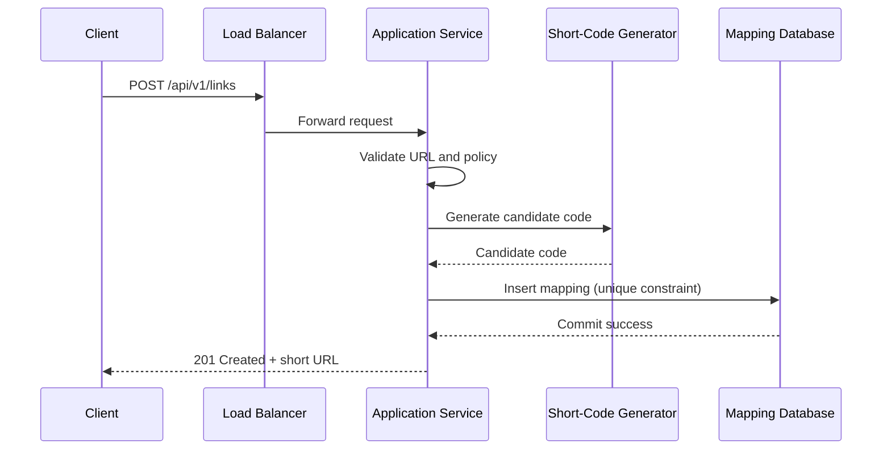
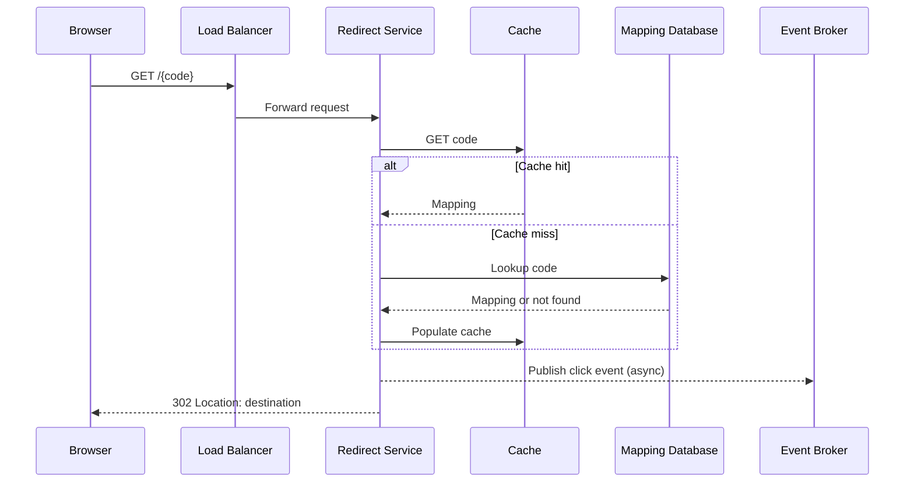
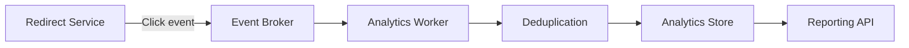

# CS-001 — Data Flow Specification

## Flow 1: Create link

## Flow 2: Redirect

## Flow 3: Analytics

## Error and edge-case paths

- Unknown code: return 404.
- Expired code: return a defined expired-link response.
- Deactivated code: do not redirect.
- Database timeout on cache miss: controlled 5xx or service-specific fallback.
- Event broker unavailable: apply the documented event durability policy; do not block redirect indefinitely.
- Duplicate event: deduplicate by event ID if exact-once aggregation is required at the application layer.
