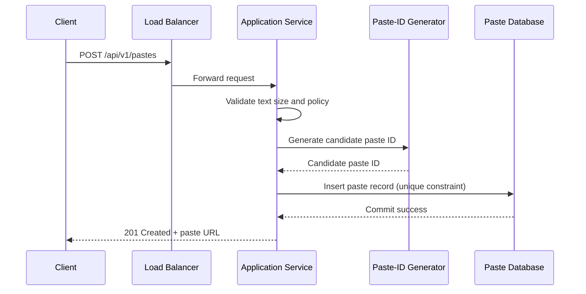
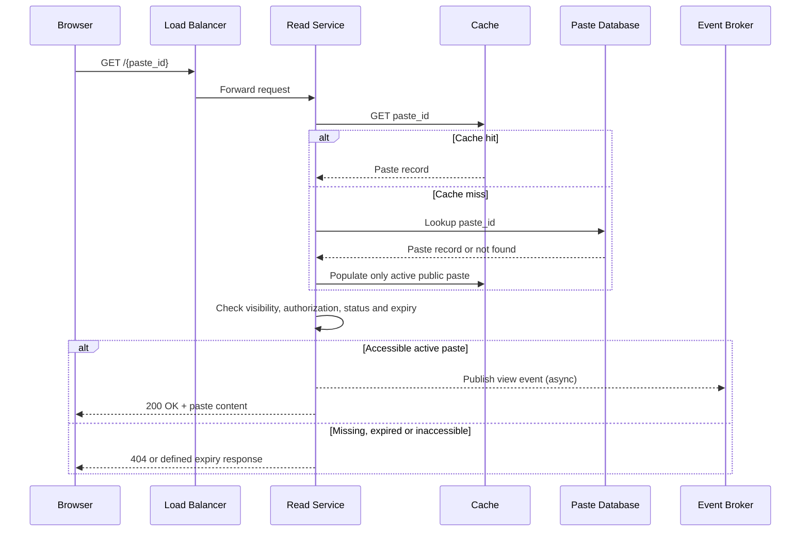

# CS-Pastebin — Data Flow Specification

## Flow 1: Create paste

## Flow 2: Read

## Flow 3: Analytics

## Error and edge-case paths

- Unknown paste ID: return 404.
- Expired paste ID: return a defined expired-paste response.
- Deactivated paste ID: do not return content.
- Database timeout on cache miss: controlled 5xx or service-specific fallback.
- Event broker unavailable: apply the documented event durability policy; do not block read indefinitely.
- Duplicate event: deduplicate by event ID if exact-once aggregation is required at the application layer.
