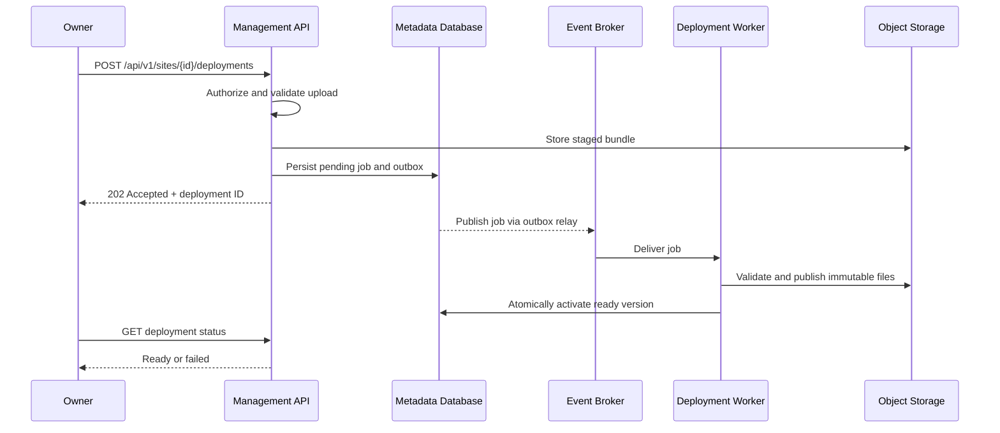
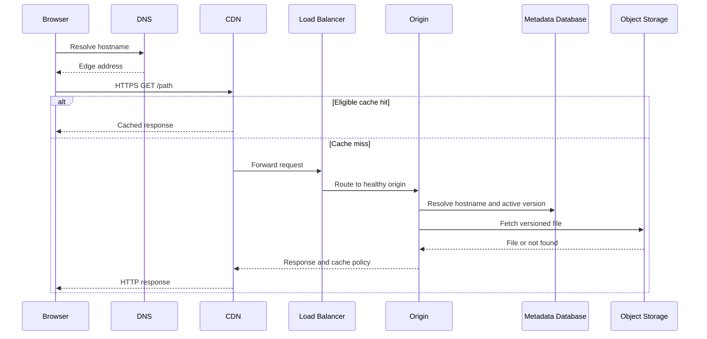
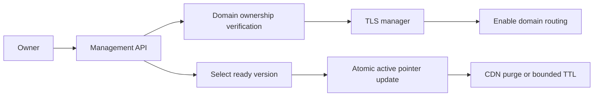

# CS-WebHosting — Data Flow Specification

## Flow 1: Create and deploy a site

## Flow 2: Serve a website

## Flow 3: Domain management and rollback

## Error and edge-case paths

- Unknown hostname or missing file: return 404.
- Unauthorized management request: return 403.
- Failed deployment: retain previous active version.
- Storage timeout: bounded retry or controlled 503.
- Broker unavailable: retain pending job in durable outbox; retry publication.
- Duplicate job: use deployment ID and conditional activation to prevent stale retries from replacing newer versions.
