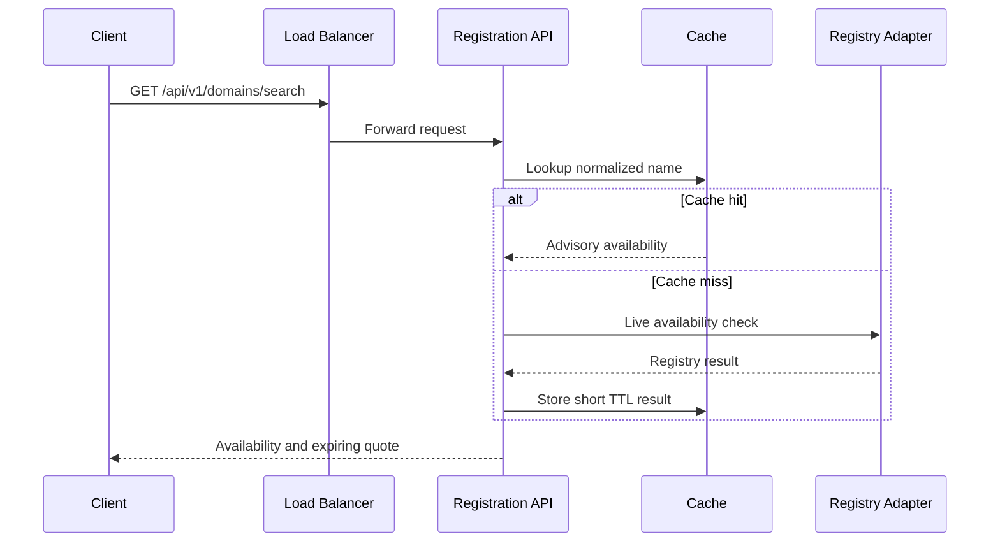
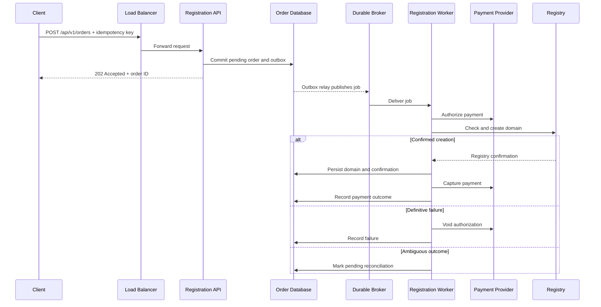
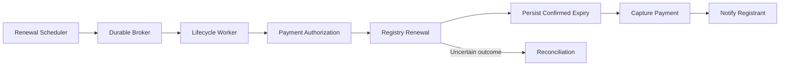

# CS-DomainRegistration — Data Flow Specification

## Flow 1: Search domain

## Flow 2: Register domain

## Flow 3: Renewal and lifecycle

## Error and edge-case paths
- Invalid name: 400; unsupported TLD: defined validation error.
- Unavailable name: reject order; cached search is advisory.
- Duplicate idempotency key: return existing order; conflicting payload: 409.
- Registry timeout: reconcile before retrying create or renewal.
- Payment capture failure after creation: retain confirmed domain and escalate billing.
- Broker unavailable: retain durable outbox and replay; never report unconfirmed success.
