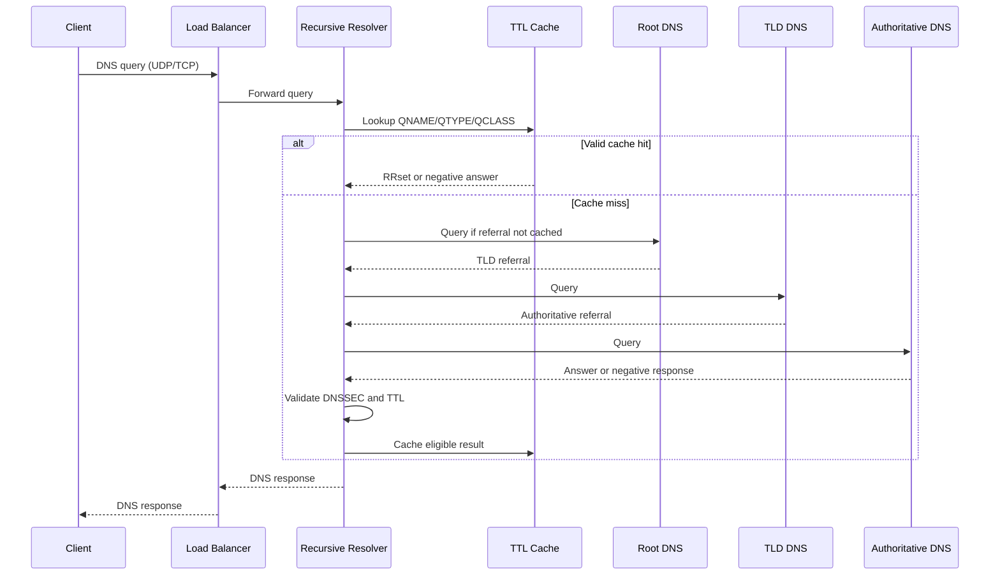
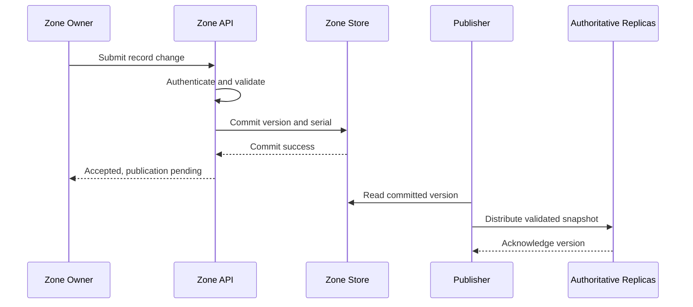

# CS-DNSService — Data Flow Specification

## Flow 1: Resolve DNS query

## Flow 2: Publish authoritative zone update

## Flow 3: Analytics

## Error and edge-case paths
- Unknown name: NXDOMAIN; existing name without requested type: NOERROR/NODATA.
- Expired cache entry: resolve again; do not reset TTL on cache hits.
- Upstream timeout: bounded retries, then SERVFAIL.
- Bogus DNSSEC result: SERVFAIL under normal validation policy.
- Truncated UDP response: retry using TCP as appropriate.
- Publication failure: retain last valid zone version and retry; report pending status.
- Telemetry outage: follow defined buffering/drop policy without blocking resolution.
