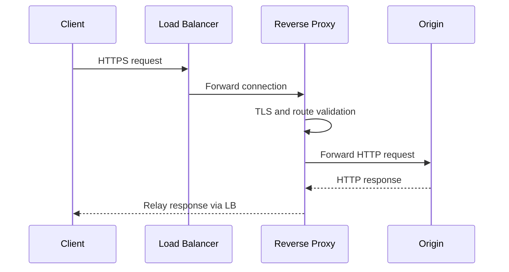
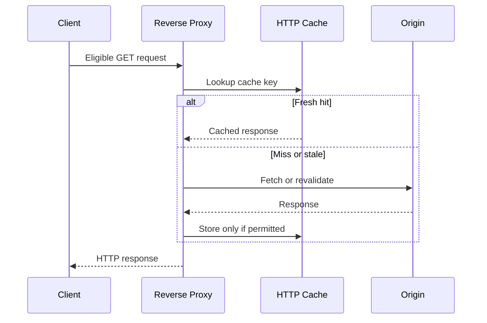
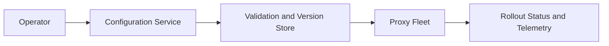

# CS-ReverseProxy — Data Flow Specification

## Flow 1: Forward request

## Flow 2: Cache lookup

## Flow 3: Configuration update

## Error and edge-case paths
- Unknown route: 404; malformed request: 400.
- No healthy origin: 503; origin timeout: 504 if headers not sent.
- Cache failure: bypass with origin load protection.
- Invalid configuration: reject; retain last known good version.
- Do not retry non-idempotent requests automatically without an explicit safe policy.
