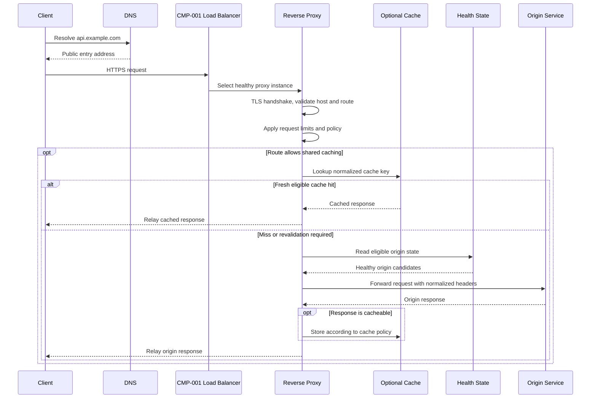
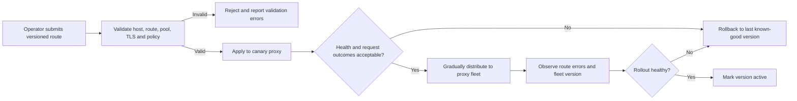

# CS-006 — Data Flow Specification

## Flow 1: Client request and origin response



## Flow 2: Origin health and failover

```mermaid
sequenceDiagram
    participant H as Health Checker
    participant O1 as Origin 1
    participant O2 as Origin 2
    participant S as Proxy Pool State
    participant RP as Reverse Proxy

    H->>O1: Readiness probe
    O1-->>H: Probe result
    H->>S: Update health after configured thresholds
    RP->>S: Get eligible origins
    S-->>RP: Healthy origins only
    RP->>O2: Route new request
    Note over RP,O1: In-flight requests follow timeout/drain policy; they are not automatically safe to replay
```

## Flow 3: Configuration rollout



## Error and edge-case paths

- Unknown hostname or unconfigured route: reject without forwarding to a default arbitrary origin.
- No healthy origin: return a controlled 503 and emit an alert.
- Upstream connection failure: return 502 or bounded retry only when the request is safe to retry.
- Upstream timeout: return 504; enforce a bounded deadline.
- Invalid upstream response: return 502 and record the origin and protocol failure.
- Rate limit exceeded: delay within configured burst or return 429.
- TLS validation failure to origin: fail closed; do not disable certificate verification.
- Private or authenticated response: bypass shared cache unless an explicit safe policy exists.
- Control plane unavailable: continue with last known-good configuration and expose its version/age.
- Client disconnects during streaming: cancel upstream work when safe and release resources.
