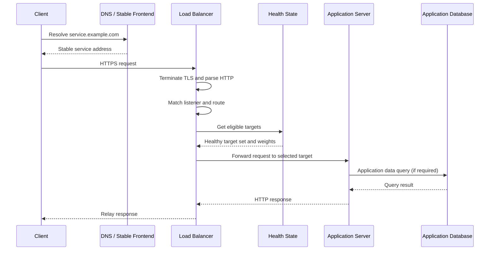
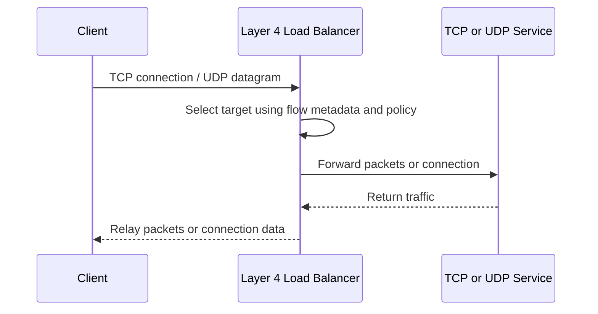
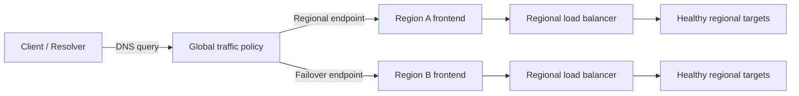
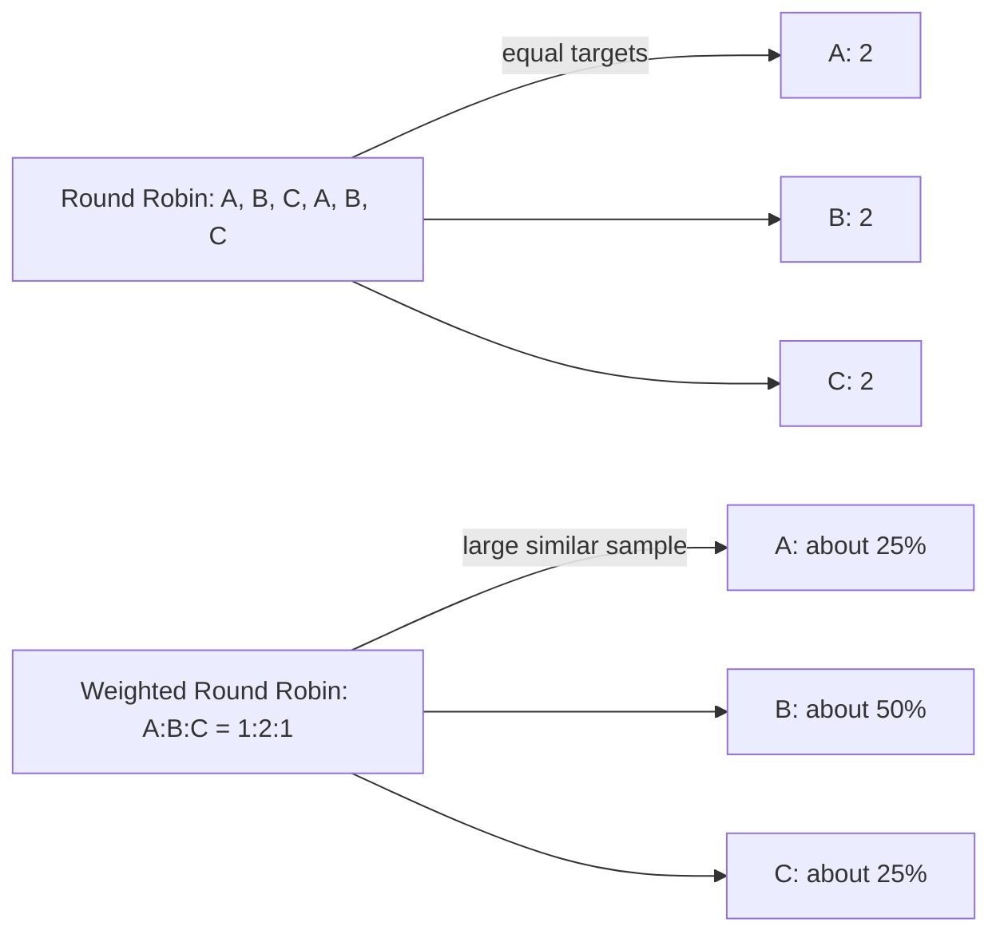
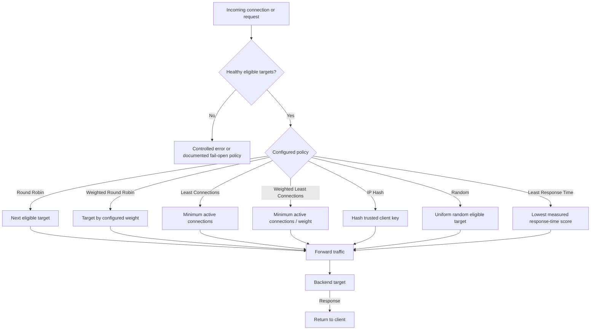
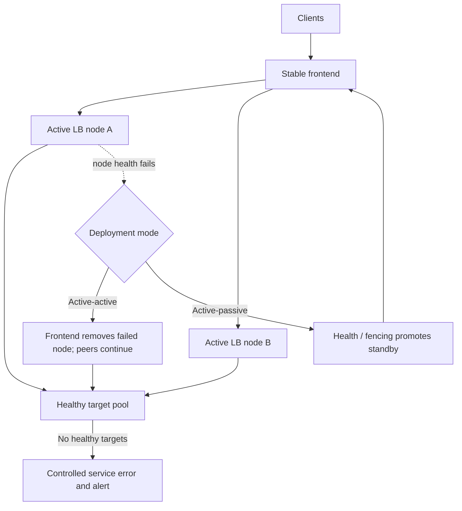

# CS-007 — Data Flow Specification

## Flow 1: Layer 7 request and response



The load balancer makes a routing decision from configuration and health state. The application server—not the load balancer—normally queries the application's database.

## Flow 2: Layer 4 connection forwarding



Layer 4 typically selects a target for a flow and does not parse HTTP paths or headers. Exact source-address preservation, connection tracking, and UDP behavior depend on implementation.

## Flow 3: Health detection and failover

```mermaid
sequenceDiagram
    participant H as Health Checker
    participant A as Target A
    participant B as Target B
    participant P as Target Pool State
    participant LB as Load Balancer

    H->>A: Readiness probe
    A-->>H: Probe timeout / failure
    H->>P: Mark A unhealthy after threshold
    LB->>P: Select eligible target for new request
    P-->>LB: B only
    LB->>B: Forward new request
    H->>A: Recovery probe
    A-->>H: Successful probe
    H->>P: Mark A healthy after recovery threshold
    Note over LB,A: Existing connections follow drain/reset behavior; no safe replay is assumed
```

## Flow 4: Global steering and regional balancing



DNS policy influences the address returned to a resolver; cached answers can persist until their TTLs expire. The regional frontend then performs its own health-aware target selection.

## Algorithm distribution examples



For state-aware policies, consider eligible targets `A=(8 active, weight 2, 40 ms)`, `B=(3 active, weight 1, 20 ms)`, and `C=(5 active, weight 1, 25 ms)`:

| Policy | Example decision | Notes |
|---|---|---|
| Least Connections | Select B because 3 active connections is the minimum | Counts connections, not CPU work |
| Weighted Least Connections | Using the example score `active / weight`: A=4, B=3, C=5; select B | One common model; implementations vary |
| IP Hash | If the client key hashes to B, select B again for that key | Affinity may change with pool membership |
| Random | Select any of A/B/C uniformly; one run might select C | Short samples can be uneven |
| Least Response Time | Select B if its measured response-time score is lowest | Use a documented window and score; measurements can lag |



Algorithm semantics depend on whether the unit is a connection, request, or stream and on the chosen implementation.

- Least Connections selects the eligible target with the smallest active connection count.
- Weighted Least Connections commonly compares `active_connections / weight`; implementations may use different scoring rules.
- IP Hash maps the client key to a target; affinity is not guaranteed after pool membership changes.
- Random selects an eligible target uniformly; short samples can be uneven.
- Least Response Time uses observed response latency, often with outstanding work; measurement and tie-breaking are implementation-specific.

## Flow 5: Active-active and active-passive failover



In active-passive deployments, ownership/fencing prevents two nodes from simultaneously claiming a single VIP. Existing connections may reset during node failover in either mode.

## Error and edge-case paths

- No healthy targets: return a controlled service error or apply the documented provider-specific fail-open behavior.
- Backend connect timeout: mark/observe failure, select an alternate target only within bounded and safe retry policy.
- All targets fail health checks: alert; do not assume fail-open or fail-closed without explicit configuration.
- Load-balancer node fails: stable frontend withdraws or fails over; existing connections may reset.
- Health endpoint fails while requests are served: investigate probe representativeness and readiness policy.
- TLS termination fails: reject connection; do not silently downgrade HTTPS.
- Client disconnects: release connection state; do not replay a possibly processed non-idempotent request.
- Database failure: backend application reports dependency failure; the load balancer does not query the database as a substitute.
- DNS region failover: allow for recursive resolver/client caching and propagation delay.
