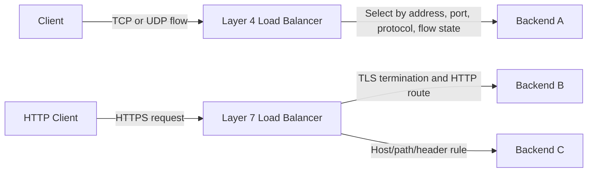

# CS-007 — Design a Load Balancer

> **Content status:** Educational reference design. This document proposes a generic, highly available load-balancing service; it does not claim to describe any vendor's private production architecture. Numerical workload and performance values are illustrative assumptions.
>
> **Source alignment:** The Codorythm case-study catalogue identifies this as Case Study 7 in Category A: Web & Internet Systems. The required structure follows the 18-section case-study template.

## A. Basic information

| Field | Value |
|---|---|
| Case Study ID | CS-007 |
| System name | Load Balancer |
| Real-world reference | NGINX, HAProxy, Envoy, and AWS Elastic Load Balancing are implementation examples, not asserted system designs |
| Category | Web & Internet Systems |
| Category number | A |
| Case number | 7 |
| Difficulty | Beginner to Intermediate |
| Short description | Design a highly available service that accepts client connections, selects healthy backend targets using a routing policy, and forwards traffic while exposing safe configuration and operational telemetry. |
| Primary users | Application clients, application teams, platform operators, network engineers, security and reliability engineers |
| Key concepts | Layer 4 and Layer 7 routing, health checks, load-balancing algorithms, connection management, TLS, session persistence, high availability, scaling, observability |
| Related component IDs | CMP-001 (Load Balancer); this case study develops a system-level design for the component specification |
| Research status | Draft reference content |
| Researcher | To be assigned |
| Reviewer | To be assigned |
| Last updated | 2026-11-14 |

### Scope and assumptions

- The system provides regional Layer 4 and Layer 7 load-balancing data planes for application workloads.
- Client traffic arrives through a stable service address or provider-managed endpoint; IP anycast, a virtual IP (VIP), or a managed network front end may provide that entry mechanism.
- Control-plane configuration is versioned and validated before reaching the request-serving data plane.
- Backend health, service discovery, listener configuration, and routing policy are inputs to request selection.
- Application instances connect to their own databases and dependencies. A load balancer forwards application traffic; it should not query application databases to make ordinary routing decisions.
- The initial workload is one region. DNS-based global server load balancing is an extension and is not equivalent to instant global failover.
- All workloads, capacities, availability targets, and latency values below are illustrative teaching assumptions, not vendor benchmarks.

---

## 01 — Story

An application starts on one server. As the number of users grows, that server approaches its CPU, memory, connection, and network limits. A server failure or maintenance event also makes the entire service unavailable. Adding more application instances increases potential capacity, but clients still need a reliable way to discover the service and send each request to an instance that can handle it.

A load balancer provides a stable frontend and selects a backend from a pool. It monitors or observes target health, distributes connections or requests according to a configured policy, and returns backend responses to clients when it operates as a proxy. The design must also avoid becoming a single point of failure, protect backends from overload, and make routing decisions observable and safe to change.

### Actors

1. **Client:** Opens a connection or sends a request to the service's stable address.
2. **Application owner:** Registers backend targets, listeners, and routing policies.
3. **Load-balancer data plane:** Accepts traffic, selects eligible targets, and forwards connections or requests.
4. **Backend service:** Processes application requests and may access its database or other dependencies.
5. **Control-plane operator:** Publishes validated configuration and target membership.
6. **Reliability / security operator:** Monitors traffic, failures, capacity, and abuse.

### Core user journey

1. An application owner creates a listener and registers several backend targets.
2. The control plane validates the configuration and distributes it to the load-balancer fleet.
3. Health checks establish which targets are eligible for new traffic.
4. A client connects to the stable service endpoint.
5. A load-balancer node accepts the traffic and selects an eligible target using the configured algorithm.
6. The selected application server handles the request and accesses its own database if needed.
7. The load balancer relays the response or forwards packets back to the client.
8. Operators inspect target health, traffic distribution, latency, errors, and saturation.

### Problem boundaries

This case study designs the load-balancing service and its interaction with application backends. It does not design the application, database, DNS service, complete web application firewall, or global content-delivery network. A load balancer can improve traffic distribution and availability, but it does not make an application or its dependencies highly available automatically.

---

## 02 — Requirements

### Functional requirements

| ID | Requirement | Priority |
|---|---|---|
| FR-01 | Accept TCP/UDP connections at Layer 4 and HTTP/HTTPS requests at Layer 7 where configured | Must |
| FR-02 | Distribute traffic only to registered and eligible backend targets | Must |
| FR-03 | Support Round Robin, Weighted Round Robin, Least Connections, Weighted Least Connections, IP Hash, Random, and Least Response Time where the selected implementation supports them | Must |
| FR-04 | Perform or consume backend health checks and stop selecting unhealthy targets | Must |
| FR-05 | Support multiple listeners and backend pools with explicit routing rules | Must |
| FR-06 | Preserve the client source address at Layer 4 or convey trusted client metadata at Layer 7 where configured | Should |
| FR-07 | Support TLS termination and separately configured encryption to backend targets | Should |
| FR-08 | Support connection draining and controlled target registration/removal | Must |
| FR-09 | Provide configurable connection/request timeouts and bounded overload behavior | Must |
| FR-10 | Support optional session persistence with documented affinity behavior | Should |
| FR-11 | Update listeners, targets, health policy, and routing configuration through validation and controlled rollout | Must |
| FR-12 | Provide metrics and logs for traffic, health, latency, errors, and resource usage | Must |
| FR-13 | Support redundant load-balancer instances and failover without requiring client reconfiguration | Must |
| FR-14 | Apply access controls and rate/connection limits where appropriate | Should |

### Non-functional requirements

| ID | Requirement | Initial target / policy |
|---|---|---|
| NFR-01 | Added data-plane latency | Illustrative p95 under 5 ms in-region for a healthy target, excluding application processing |
| NFR-02 | Availability | Illustrative 99.99% monthly for the regional frontend, subject to network and backend availability |
| NFR-03 | Capacity | Sustain assumed peak after loss of one load-balancer node and one backend target |
| NFR-04 | Health detection | Remove a failed target within a bounded configured detection interval; avoid excessive flapping |
| NFR-05 | Horizontal scalability | Add data-plane capacity without a central per-request coordination dependency |
| NFR-06 | Configuration safety | Reject invalid configuration and support versioned rollout and rollback |
| NFR-07 | Security | Encrypt client traffic where required, restrict management access, and protect backend communication |
| NFR-08 | Observability | Measure per-listener and per-target traffic, health, latency, and resource saturation |
| NFR-09 | Isolation | A noisy listener or tenant should not exhaust all shared capacity without an explicit policy |

### Out of scope for the initial version

- Application-level business routing and authorization.
- Persistent session state or application data replication.
- A complete DDoS scrubbing network.
- Global anycast infrastructure implementation.
- Guaranteed exactly-once request delivery.
- Vendor-specific service limits or performance guarantees.

---

## 03 — Scale

All values in this section are **illustrative workload assumptions for teaching and simulation**. They are not vendor disclosures or benchmark claims.

### Workload assumptions

| Metric | Illustrative value | Reasoning |
|---|---:|---|
| Registered services / listeners | 500 | Several application teams and environments |
| Average request rate | ~1,157 RPS | 100,000,000 requests/day / 86,400 seconds |
| Peak request rate | 10,000 RPS | Approx. 8.6× average for bursty service traffic |
| Average request bytes | 8 KiB | Headers and small request bodies, simplified |
| Average response bytes | 32 KiB | Mixed API and web responses, simplified |
| Peak aggregate traffic | ~3.28 Gbit/s | 10,000 × (8 + 32) KiB × 8, decimal bits/sec |
| Data-plane nodes | 4 at 8,000 tested RPS each | 32,000 RPS nominal capacity |
| Capacity after one node failure | 24,000 RPS | 2.4× assumed peak before safety derating |
| Backend targets | 6 at 5,000 RPS each | 30,000 RPS nominal capacity |
| Backend capacity after one target failure | 25,000 RPS | 2.5× assumed peak before safety derating |
| Client connection duration | 5 seconds average | Simplified connection-pressure assumption |
| Added latency objective | p95 < 5 ms | Regional target excluding backend execution |
| Availability objective | 99.99% monthly | Illustrative regional frontend objective |

### Capacity notes

- RPS is not a sufficient load-balancer capacity metric. Connection churn, concurrent connections, protocol, payload size, TLS handshakes, logging, and health-check traffic also affect capacity.
- Little's Law estimates average concurrent requests/connections as `L = λ × W`. At 10,000 requests/sec and a 5-second average lifetime, that is approximately 50,000 in-flight connections before considering protocol multiplexing.
- Four data-plane nodes at the assumed per-node capacity retain 24,000 RPS after one node failure, but production headroom must include workload mix and burst behavior.
- Backend capacity is independently constrained by application and database capacity. A load balancer cannot create backend capacity.
- A Layer 7 TLS-terminating design usually performs more per-request work than a Layer 4 pass-through design; benchmark the actual protocol and cipher configuration.
- Health-check traffic, control-plane updates, connection draining, and retries must be included in resource and failure planning.

### Questions for a production sizing exercise

- What is the distribution of new connections, requests per connection, and connection duration?
- Are clients using TCP, UDP, HTTP/1.1, HTTP/2, HTTP/3, WebSockets, or streaming?
- What request and response sizes, TLS handshake rates, and cipher requirements are expected?
- How much backend capacity remains during a zone failure?
- Are client IP preservation, affinity, or cross-zone balancing required?
- Which SLOs apply to the load balancer itself versus the complete application?

---

## 04 — Naive Architecture

### Simplest viable design

A single load-balancer process listens on one address and distributes incoming requests across two application servers. Both application servers use a shared database for persistent application data.

**Components**
- Client/browser
- Single load-balancer process
- Two application servers
- Shared application database
- Basic health-check loop

**Request flow**
1. Client connects to the load balancer's stable address.
2. Load balancer selects an application server using Round Robin.
3. Application server processes the request and accesses the database when required.
4. Application server returns a response through the load balancer.
5. Load balancer sends the response to the client.

### Naive architecture diagram

See `architecture.png`.

### Why begin here?

This design establishes the central function: receive traffic and distribute it across interchangeable backends. It makes the single-node failure and capacity problem visible before introducing health-aware pools, redundant load-balancer nodes, control-plane rollout, and global routing.

---

## 05 — Problems

| Problem | Why it occurs | User/system impact | Likely improvement |
|---|---|---|---|
| Single load-balancer failure | One process or host owns the only frontend | Entire service becomes unreachable | Redundant data-plane nodes and stable failover entry |
| Single node saturation | CPU, network, connection table, or file descriptors are exhausted | Queueing, dropped connections, and high latency | Capacity testing, horizontal scale, and load shedding |
| Backend failure | Requests continue to reach a failed or degraded server | Errors and retries increase | Health checks, passive failure detection, and target removal |
| Unequal backend capacity | Equal distribution ignores target size | Smaller targets overload while larger targets are idle | Weights or adaptive policy |
| Unequal request cost | Request counts do not represent work | CPU-heavy or long-running requests create hot targets | Least-connections/adaptive routing and workload isolation |
| Sticky-session dependence | Application session is stored only on one server | Client failures after target loss; uneven load | Shared session store or stateless application design |
| Health-check mismatch | Probe checks process liveness but not service readiness | Bad target remains active or healthy target flaps | Readiness-aware probes and carefully tuned thresholds |
| Database mistaken as an LB dependency | Load balancer queries application data store in the request path | Adds latency and couples routing to application schema | Keep routing state in control plane; app servers access their databases |
| Configuration inconsistency | Nodes receive changes at different times | Different clients see different routing behavior | Versioned config, staged rollout, and config-version telemetry |
| Cross-zone imbalance | Traffic stays local or target registration differs by zone | Hot zones and uneven failure capacity | Explicit cross-zone policy and per-zone metrics |
| TLS concentration | Termination adds CPU, memory, and certificate work | Handshake saturation or latency | Scale TLS capacity, reuse sessions, and benchmark ciphers |
| Retry amplification | Failed requests are retried without limits | Backend overload worsens | Bounded retries, backoff, and safe retry semantics |
| Global DNS failover delay | Resolver and client caches retain answers | Traffic continues toward failed region | TTL-aware design, health policy, and realistic convergence expectations |

---

## 06 — Architecture Evolution

These are proposed learning stages, not a historical account of any named vendor's architecture.

### V1 — Single load balancer and application pool

- One load-balancer process forwards traffic to a small backend pool.
- Begin with Round Robin and basic connectivity checks.
- Application servers share their own database or application dependencies.
- Limitation: load balancer is a single point of failure and has limited capacity.

### V2 — Health-aware target pools and richer policies

- Add active readiness checks and passive connection/error observation.
- Remove unhealthy targets from new-traffic selection and reintroduce them after recovery thresholds.
- Add Weighted Round Robin or Least Connections when backend capacity or request duration differs.
- Add graceful drain for deployments and target removal.
- Benefit: reduces new traffic to failed targets and supports heterogeneous backends.
- New concern: health-check thresholds, detection delay, and policy-specific semantics.
- The target-pool and health-check flow is shown in `architecture-evolved.png`.

### V3 — Redundant data plane and stable frontend

- Run multiple data-plane nodes across hosts and availability zones.
- Use a managed network entry point, redundant VIP with failover, or IP anycast/BGP according to deployment requirements.
- Use active-active nodes for aggregate capacity or active-passive nodes for simpler stateful failover.
- Keep health checks and routing decisions available locally on each node.
- Benefit: node failure no longer removes the only service endpoint.
- New concern: shared frontend failover, state synchronization, cross-zone capacity, and split-brain prevention.

### V4 — Control plane, security, and observability

- Separate control-plane configuration from per-packet/per-request data-plane work.
- Validate listeners, targets, weights, health checks, certificates, and policies before distribution.
- Roll configuration through a canary and staged fleet update with rollback.
- Add TLS termination, access controls, connection limits, optional rate limiting, and protocol-aware routing.
- Emit per-listener, per-target, and per-zone telemetry.
- New concern: control-plane consistency, certificate rotation, high-cardinality telemetry, and safe defaults.

### Global evolution

- Deploy regional load-balancer fleets and use DNS-based or anycast global traffic steering.
- Use health and proximity policy to select a region, then regional load balancing to select a target.
- Account for DNS caching and TTLs; DNS failover is not instantaneous for every client.
- Define data locality, active-active write semantics, regional capacity reserve, and failback behavior.
- Ensure that global steering does not route users to a healthy load balancer whose application dependencies are unavailable.

### Layer 4 versus Layer 7

| Property | Layer 4 | Layer 7 |
|---|---|---|
| Decision input | IP, protocol, and transport connection data | HTTP host, path, headers, method, or other parsed request data |
| Typical behavior | Select a target for a TCP/UDP flow and forward packets/connection | Select a target per HTTP request/stream and may terminate TLS |
| Protocol visibility | Payload is generally opaque | Application protocol is parsed |
| Strength | Lower protocol-level processing and supports non-HTTP traffic | Rich routing, request-level policy, and HTTP-aware observability |
| Limitation | Cannot route by URL path or HTTP header | More CPU/memory work; parser and TLS policy add complexity |
| Typical examples | TCP database front end, UDP service distribution, TLS pass-through | Web applications, APIs, host/path routing |

Layer 4 and Layer 7 are deployment choices, not a simple speed ranking. A TLS-terminating Layer 7 balancer can route on decrypted HTTP metadata; a TLS pass-through design cannot inspect encrypted paths.

### Deployment forms and global server load balancing

| Form | How it is delivered | Strengths | Trade-offs |
|---|---|---|---|
| Hardware load balancer | Purpose-built appliance in a data center | Specialized networking and acceleration features; predictable appliance profile | Upfront and support cost, fixed capacity steps, vendor dependence, and appliance-level failure domain |
| Software load balancer | Software on commodity servers, VMs, or containers | Flexible deployment, automation, and horizontal scaling | Requires host, NIC, kernel, capacity, and upgrade operations |
| Cloud-managed load balancer | Provider-operated service with configured listeners and target groups | Managed fleet, integrated health checks, and cloud networking | Provider limits, cost model, feature semantics, and less control over implementation |
| Global server load balancing (GSLB) | DNS policy or a global network steers clients to regional endpoints | Routes toward healthy or lower-latency regions and supports regional failover | DNS answers are cached; failover is not immediate, and regional capacity/data readiness must be planned |

GSLB makes a coarse region or point-of-presence decision; the regional Layer 4 or Layer 7 load balancer still selects a backend. Hardware/software describes implementation form, while Layer 4/Layer 7 describes routing visibility—these are separate dimensions.

### Practical implementation examples

The following configuration fragments illustrate implementation patterns. Replace addresses, certificates, limits, and health policies, and validate against the exact product release before deployment.

**NGINX HTTP upstream**

```nginx
http {
    limit_req_zone $binary_remote_addr zone=api_limit:10m rate=20r/s;

    upstream app_pool {
        # Default is weighted Round Robin; these weights yield a 1:2:1 share.
        server 10.0.1.11:8080 weight=1 max_fails=3 fail_timeout=10s;
        server 10.0.1.12:8080 weight=2 max_fails=3 fail_timeout=10s;
        server 10.0.1.13:8080 weight=1 max_fails=3 fail_timeout=10s;
        keepalive 64;
    }

    server {
        listen 443 ssl;
        server_name app.example.com;
        ssl_certificate     /etc/nginx/tls/fullchain.pem;
        ssl_certificate_key /etc/nginx/tls/private.key;

        location / {
            limit_req zone=api_limit burst=40 nodelay;
            proxy_pass http://app_pool;
            proxy_http_version 1.1;
            proxy_set_header Connection "";
            proxy_set_header Host $host;
            proxy_set_header X-Forwarded-For $remote_addr;
            proxy_set_header X-Forwarded-Proto $scheme;
            proxy_connect_timeout 2s;
            proxy_read_timeout 30s;
        }
    }
}
```

In the open-source NGINX HTTP upstream module, Round Robin (weighted when weights are configured) is the default; `least_conn;`, `ip_hash;`, and `random;` are separate group policies. `limit_req` is a per-key example, not a complete DDoS defense; tune its key and threshold for the workload because many legitimate users may share an IP. NGINX passive failure parameters are not equivalent to an active readiness probe; confirm active health-check availability for the product edition. Header handling assumes a direct client connection; behind a trusted proxy, configure trusted source ranges rather than trusting client-supplied forwarding headers.

**HAProxy HTTP frontend**

```haproxy
global
    maxconn 20000

defaults
    mode http
    option httplog
    timeout connect 2s
    timeout client 30s
    timeout server 30s

frontend public_http
    bind :80
    default_backend application_pool

backend application_pool
    balance leastconn
    option httpchk GET /readyz
    http-check expect status 200
    server app1 10.0.1.11:8080 check
    server app2 10.0.1.12:8080 check weight 2
    server app3 10.0.1.13:8080 check
```

For HTTPS termination, configure a TLS certificate on the HAProxy `bind` line and set a secure TLS policy; for backend TLS, configure server-side TLS and certificate verification. `balance` policy and health-check semantics should be checked against the exact HAProxy release.

**Envoy**

Envoy models the data plane using listeners, filters, routes, clusters, and endpoints. HTTP Connection Manager filters parse HTTP and select routes; a cluster defines upstream endpoints, load-balancing policy, connection pools, and optional active health checks. Weighted Round Robin, weighted least request, random, ring hash, and Maglev are among documented policy families; names and behavior differ from other products. Use Envoy's versioned configuration reference and validation tooling rather than copying an unversioned configuration into production.

This minimal static-resource fragment demonstrates HTTP routing to a Least Request cluster. It omits production TLS, access logging, health checks, and admin-interface hardening:

```yaml
static_resources:
  listeners:
    - name: ingress_http
      address:
        socket_address: { address: 0.0.0.0, port_value: 10000 }
      filter_chains:
        - filters:
            - name: envoy.filters.network.http_connection_manager
              typed_config:
                "@type": type.googleapis.com/envoy.extensions.filters.network.http_connection_manager.v3.HttpConnectionManager
                stat_prefix: ingress
                route_config:
                  name: local_route
                  virtual_hosts:
                    - name: app
                      domains: ["*"]
                      routes:
                        - match: { prefix: "/" }
                          route: { cluster: app_pool }
                http_filters:
                  - name: envoy.filters.http.router
                    typed_config:
                      "@type": type.googleapis.com/envoy.extensions.filters.http.router.v3.Router
  clusters:
    - name: app_pool
      type: STATIC
      connect_timeout: 0.25s
      lb_policy: LEAST_REQUEST
      load_assignment:
        cluster_name: app_pool
        endpoints:
          - lb_endpoints:
              - endpoint:
                  address:
                    socket_address: { address: 10.0.1.11, port_value: 8080 }
              - endpoint:
                  address:
                    socket_address: { address: 10.0.1.12, port_value: 8080 }
```

Validate a complete configuration with the matching Envoy release and add active health checks, timeouts, retries, circuit breakers, and TLS policy according to the workload before deployment.

**AWS Elastic Load Balancing**

- **Application Load Balancer (ALB):** Layer 7 HTTP/HTTPS listeners, listener rules, target groups, TLS termination, and target-group health checks.
- **Network Load Balancer (NLB):** Layer 4 TCP/UDP/TLS service with target groups and health checks; connection and source-address behavior differ from ALB.
- **Gateway Load Balancer (GWLB):** distributes traffic to virtual network appliances; it is not a general HTTP request router.
- Use multiple Availability Zones and target groups deliberately. Health checks are per target group, and cross-zone behavior, fail-open behavior, target deregistration, and algorithm choices must be verified for the service and current configuration.
- Route 53 health/latency/weighted policies can steer DNS answers between regional endpoints, but resolver caching means failover convergence is not immediate.
- For a concrete ALB deployment, create an ALB spanning the selected Availability Zones, attach an HTTPS listener and certificate, add host/path listener rules to target groups, register application targets, set a readiness-path health check, and restrict target ingress to the ALB security group. Add a separate HTTP-to-HTTPS redirect only if required by the service policy.
- AWS documents that an ALB can establish HTTPS connections to targets without validating their certificates. Do not treat this as backend certificate-identity verification; use a design with explicit upstream validation or application-level mutual TLS where that assurance is required.

### Scaling design choices

- **Vertical scaling:** Increase CPU, memory, NIC bandwidth, and connection-table capacity per node. This is operationally simple but has a ceiling and retains host failure risk.
- **Horizontal scaling:** Add independent data-plane nodes behind a stable frontend. This increases aggregate capacity and fault tolerance, but requires health-aware distribution and consistent configuration.
- **Auto-scaling:** Add capacity using measured saturation and sufficient warm-up time. Do not rely on reactive scaling as the only response to sudden bursts; maintain pre-provisioned headroom.
- **Active-active:** Multiple nodes serve traffic concurrently. Provides aggregate capacity and rapid node failover but requires safe state handling and distributed health visibility.
- **Active-passive:** A standby takes over a VIP or route after failure. Simplifies active state but requires tested failover, fencing/split-brain controls, and standby capacity.

---

## 07 — Components

| Component ID | Component | Responsibility | Required? |
|---|---|---|---|
| CMP-001 | Load Balancer | The traffic-distribution component designed by this case study | Yes |
| TBD | Client | Opens a connection or sends a request to the stable service endpoint | Yes |
| TBD | Stable Frontend / VIP / Anycast | Delivers traffic to a healthy load-balancer node | Yes |
| TBD | Control Plane / Configuration Store | Validates and publishes listeners, pools, policies, and certificates | Recommended |
| TBD | Health Checker / Service Discovery | Tracks target readiness and pool membership | Yes |
| TBD | Backend Target Pool | Application instances receiving forwarded traffic | Yes |
| TBD | Application Database | Stores application data and is accessed by backend services, not by normal LB request selection | Workload-dependent |
| TBD | TLS Certificate / Secret Management | Provisions, protects, and rotates certificates and trust roots | HTTPS termination |
| TBD | Monitoring / Observability | Collects request/connection metrics, logs, traces, and alerts | Yes |
| TBD | Global Traffic Steering | Directs users to a region or point of presence | Optional |

**Component ID policy:** CMP-001 is the confirmed reusable load-balancer component in the starter package. Other IDs remain TBD until component specifications are created and added to the master component index. The load balancer should not query the application's database on every request; database access belongs to the backend application unless a separately justified data-aware routing design exists.

### Component interactions

- Client → stable frontend → selected load-balancer data-plane node.
- Load Balancer → selected healthy application target; response returns through the applicable proxy/flow path.
- Health checker → target readiness endpoint or protocol-specific probe.
- Service discovery / control plane → versioned target and listener configuration.
- Backend application → application database and dependencies.
- Load Balancer → monitoring for per-listener, per-target, and resource telemetry.
- Global traffic steering → regional frontend based on configured DNS/latency/health policy.

---

## 08 — Data Flow

### Flow A: Client request and response

1. Client resolves the service name or connects to an advertised stable address.
2. The frontend routes the connection to a healthy load-balancer data-plane node.
3. The node accepts the transport connection and identifies the listener and protocol.
4. For Layer 7 TLS termination, the node negotiates TLS and parses the HTTP request.
5. The node applies listener policy and selects an eligible backend using the configured algorithm.
6. The node opens or reuses a backend connection and forwards the request or packets.
7. The backend application processes the request and accesses its own database if required.
8. The backend response returns through the load balancer, which relays it to the client.
9. Metrics and logs record the selected target, outcome, and timing.

### Flow B: Health check and target removal

1. Health checker probes each target at a configured interval and timeout.
2. Consecutive failures beyond the unhealthy threshold mark a target unhealthy.
3. Data-plane nodes stop assigning new requests/connections to that target after receiving or observing the health state.
4. Existing connections follow the protocol and drain policy; they are not assumed to be safely replayable.
5. Consecutive successful probes beyond the healthy threshold mark the target recoverable.
6. Optional slow start gradually increases traffic to the recovered target.
7. Target transitions, remaining capacity, and probe failures are emitted to monitoring.

### Flow C: Configuration rollout

1. Operator submits a versioned listener, target pool, algorithm, certificate, and health policy.
2. Control plane validates schema, target reachability policy, protocol compatibility, and resource limits.
3. A canary data-plane node loads the configuration and reports status.
4. Control plane gradually distributes the version to the fleet.
5. Fleet health, target distribution, connection errors, and latency are compared with the prior version.
6. Rollout completes or reverts to the last known-good version.
7. During control-plane outage, data-plane nodes continue with the last accepted configuration according to its expiry policy.

### Flow D: Global traffic steering

1. Client resolver requests the service hostname.
2. DNS policy selects a regional endpoint based on configured health, geography, or policy.
3. Client connects to the chosen region's stable frontend.
4. Regional load balancer selects a healthy backend in that region.
5. If a region fails, health policy changes DNS answers; clients and recursive resolvers may continue using cached answers until their TTLs expire.

### Algorithm examples

**Round Robin:** For healthy targets `[A, B, C]`, successive assignments are `A, B, C, A, B, C`. This is fair by count for equal targets and similar work, not necessarily by CPU or latency.

**Weighted Round Robin:** For weights `A:B:C = 1:2:1`, a sufficiently large stream of similar requests is assigned approximately `25%:50%:25%`. A short request sample may not match the ratio exactly.

**Least Connections:** If active counts are `A=40, B=18, C=27`, the next eligible connection goes to B. The active count is not a direct measure of work if request durations or costs differ.

**Weighted Least Connections:** One common model selects the lowest `active_connections / weight` score. With `A=(40, weight 2)` and `B=(18, weight 1)`, scores are 20 and 18, so B is selected. Product implementations may use different formulas.

**IP Hash:** `hash(client_ip) mod healthy_target_count` selects a target. It can provide affinity, but NAT can group many clients and a target-set change can remap clients.

**Random:** Select uniformly among eligible targets. Over a sufficiently large independent sample, expected shares converge toward equal distribution; short windows can be uneven.

**Least Response Time:** Choose using observed latency, often combined with outstanding work or a moving average. Measurement window, tie-breaking, and formula vary by implementation; stale or noisy observations can cause oscillation.

### Layer 4 and Layer 7 flow comparison



The Layer 4 path does not need to parse HTTP. The Layer 7 path can route using HTTP metadata only when it can inspect that metadata, usually after TLS termination.

### Error and edge-case paths

- No healthy targets: return a controlled error for proxying modes or apply a documented fail-open policy for the selected network service.
- One target fails: stop new assignments after health detection and preserve unaffected traffic.
- Client closes a connection: release backend resources and avoid unsafe replay.
- Backend times out: enforce a deadline; retry only when protocol, request semantics, and policy permit.
- Health endpoint is unreachable while application endpoint works: avoid treating an overly narrow probe as universal service truth.
- All health checks fail simultaneously: alert and follow the explicit fail-open/fail-closed policy; never assume one universal behavior.
- Load-balancer node fails: stable frontend removes or fails over from the node; existing connections may reset and need client retry.
- Database fails: backend application reports errors; the load balancer should not query the database directly to compensate.
- DNS region fails: client behavior depends on resolver caching and the configured record TTL.

---

## 09 — Failure Scenarios

| Failure | Detection | Immediate effect | Mitigation / recovery |
|---|---|---|---|
| One backend server crashes | Active probe fails or passive connection errors rise | Requests to the target fail during detection | Remove it from new selection; preserve N+1 capacity; restart and slow-start on recovery |
| One load-balancer node crashes | Frontend health probe, process monitor, or route withdrawal | Connections to that node fail; established flows may reset | Remove node from VIP/anycast/managed endpoint; remaining nodes absorb load |
| Frontend/VIP fails | External synthetic checks and route/ARP/BGP health | All data-plane nodes may be healthy but unreachable | Redundant frontend, tested VIP/route failover, fencing, and independent monitoring |
| Network partition to a target | Connect timeout, packet loss, active probe failure | Some clients cannot reach target even if process is healthy | Route to reachable targets, repair path, avoid unbounded retries |
| Health check is too permissive | Successful probe while requests fail | Bad target remains eligible | Probe readiness/dependency state; monitor real request errors separately |
| Health check is too aggressive | Probe failures during transient latency | Healthy targets flap out of service | Tune timeout and thresholds; add recovery hysteresis and slow start |
| Uneven request distribution | Per-target counters, utilization, and latency diverge | One target overloads while others are underused | Check algorithm, weights, persistence, target capacity, and client skew |
| Sudden traffic spike | RPS, connections, queues, and utilization rise | Queueing, dropped connections, and backend saturation | Maintain headroom, shed load, rate-limit, scale, and protect origins |
| All targets overloaded | High queueing and response latency across pool | Service latency and error rates rise | Backpressure, bounded queues, safe load shedding, and capacity recovery |
| LB configuration rollout is invalid | Validation or canary load fails | Some nodes may reject config or route incorrectly | Validate before rollout, canary, version fleet state, and rollback |
| TLS certificate expires | Handshake failures and expiry monitor | HTTPS clients cannot connect | Automated renewal, alerting, protected key distribution, staged rotation |
| Active-active state diverges | Different target/config/session state across nodes | Inconsistent routing or affinity | Keep request decisions stateless where possible; version config and scope shared state |
| Active-passive split brain | Both nodes claim the same VIP | Duplicate traffic, conflicting state, or network instability | Fencing, quorum/lease policy, and tested failover ownership |
| DNS/global region failure | External probes and DNS health policy | Some clients continue routing to failed region | Regional redundancy, low but sensible TTL, resolver-aware failover testing |
| Backend database fails | Application errors and dependency telemetry | Application targets return errors despite healthy process checks | Backend-level readiness policy; recover database; avoid LB database coupling |
| DDoS or connection exhaustion | Connection rate, SYN/UDP volume, and resource alerts | Frontend or target capacity exhausted | Upstream DDoS controls, SYN protections, ACLs, limits, and multi-layer mitigation |

Recovery should be verified with request success rate, target health, per-zone capacity, and latency—not solely by process status.

---

## 10 — Scaling

### 10× traffic

- Add data-plane nodes behind a stable frontend and validate per-node capacity using the real request and connection mix.
- Keep enough warm capacity for N+1 failure; reactive autoscaling alone may be too slow for abrupt load.
- Increase backend capacity separately and verify shared database/dependency headroom.
- Tune connection reuse, keep-alive, TLS session resumption, and health-check rate.
- Apply bounded connection/request limits and load shedding before queues grow without bound.

### 100× traffic

- Partition listeners or tenants across independently scalable pools where isolation and operations justify it.
- Use local data-plane decisions with asynchronously distributed health/configuration state rather than centralizing every request.
- Use multi-zone capacity and explicitly decide cross-zone routing and transfer costs.
- Avoid shared-state affinity bottlenecks; prefer stateless applications or a shared session store.
- Use adaptive policies only with a measured feedback loop, stable observation windows, and protection from oscillation.
- Use hierarchical monitoring and bounded-cardinality labels to keep telemetry scalable.

### 1,000× traffic

- Deploy regional points of presence and separate global region selection from regional backend selection.
- Use anycast/BGP, managed global endpoints, or DNS policies according to network control and convergence requirements.
- Pre-provision failover capacity in each region and test the largest plausible regional traffic shift.
- Isolate tenant/listener resources and enforce per-tenant connection, request, and configuration quotas.
- Scale control-plane distribution and telemetry ingestion independently from the data plane.
- Evaluate specialized hardware or kernel-bypass/network optimizations only after reproducible workload benchmarks identify the bottleneck.

### Scaling decision checklist

- Is the limiting resource CPU, TLS, network bandwidth, concurrent connections, file descriptors, target capacity, or frontend routing?
- Is the algorithm distributing bytes, connections, requests, or actual work appropriately?
- Does one failed node or zone leave sufficient peak capacity?
- Does session persistence create hot targets or complicate failover?
- Can autoscaling finish before existing capacity is exhausted?
- Is cross-zone routing preferable to local routing under the failure and cost model?
- What new operational complexity does the proposed scale layer add?

---

## 11 — Trade-offs

### Load-balancing algorithms

| Algorithm | Selection rule | Strength | Limitation |
|---|---|---|---|
| Round Robin | Pick the next eligible target in sequence | Simple, low state, fair by count for similar targets | Ignores active load and request cost |
| Weighted Round Robin | Distribute share proportional to configured target weights | Represents different configured capacity | Static weights can become stale; short windows vary |
| Least Connections | Choose the target with the fewest active connections | Useful when connection durations differ | Active count is not equal to CPU/work; long-lived streams skew it |
| Weighted Least Connections | Common model chooses the lowest `active_connections / weight` score | Factors both load proxy and configured capacity | Formula and state scope vary; state may diverge across nodes |
| IP Hash | Hash client IP to a target | Provides affinity without a cookie | NAT/client churn skews traffic; target changes can remap clients |
| Random | Uniformly select an eligible target | Low coordination; simple implementation | Short-term imbalance; does not account for target load |
| Least Response Time | Select using observed response latency, often with outstanding work | Can react to latency differences | Feedback lag/noise can cause oscillation; implementation-specific |

No algorithm is universally best. Choose based on whether the unit is a connection or request, target capacity, request-cost distribution, state availability, and session requirements. Verify the exact implementation semantics for the chosen product.

### Required decision record format

For every major decision, interns should document:
- Context and problem.
- Options considered.
- Chosen option.
- Why it was selected.
- What is gained.
- What is sacrificed.
- Conditions that would justify revisiting it.

### Additional design decisions

| Decision | Option A | Option B | Considerations |
|---|---|---|---|
| Network layer | Layer 4 | Layer 7 | Protocol visibility and lower processing vs. richer request routing |
| TLS | Pass through | Terminate at balancer | End-to-end encryption visibility vs. centralized TLS and HTTP policy |
| Session state | Sticky session | Shared/stateless app state | Easy affinity vs. uneven load and failover coupling |
| HA mode | Active-active | Active-passive | Aggregate capacity and failover speed vs. simpler ownership and standby capacity |
| Health | Active probes | Passive observation | Faster explicit detection vs. probe cost and probe/data-path mismatch |
| Regional selection | DNS-based | Anycast/managed global network | Broad reach vs. resolver convergence and operational control |
| Scaling | Vertical | Horizontal | Simpler node changes vs. redundancy and fleet-management complexity |

---

## 12 — Cost

No provider, region, instance type, network pricing, or current price list is specified. Therefore, this section provides a cost model rather than a fabricated currency estimate.

### Cost categories

| Cost item | Main cost driver | Measurement needed |
|---|---|---|
| Load-balancer service / appliance | Node-hours, capacity units, licenses, support | RPS, connections, throughput, TLS handshakes |
| Frontend address / network routing | Public IP, VIP, anycast/BGP, data processed | Sites, route announcements, ingress/egress |
| Data-plane compute | Instance-hours, CPU, memory, NIC | Protocol mix, new connections, active connections |
| Cross-zone traffic | Bytes and inter-zone transfer | Request/response bytes and routing locality |
| Backend compute | Application capacity and redundancy | RPS, CPU, memory, N+1 target count |
| Health checks | Probe traffic and monitoring | Target count, interval, regions |
| TLS/certificate management | Key operations, HSM/KMS, certificate count | Handshakes, rotations, certificate inventory |
| Global traffic steering | DNS queries or global network service | Query volume, regions, health policies |
| Observability | Log/metric/trace ingestion and retention | Events/sec, sampling, retention, cardinality |
| DDoS/security services | Scrubbed traffic, inspected requests | Peak traffic and protection tier |

### Estimation worksheet

Populate using a selected provider and region:

- Monthly LB cost = service/appliance quote for provisioned capacity and hours.
- Monthly data-plane compute = node count × hourly price × hours.
- Network cost = ingress/egress + cross-zone transfer + public address/routing charges.
- Backend cost = target count needed for normal and N+1 capacity × hourly price.
- Health-check and global-steering cost = probe/query volume × provider pricing.
- Security cost = DDoS/WAF/request inspection tier and volume.
- Observability cost = telemetry ingestion + retention + query charges.

Document date, region, currency, traffic assumptions, N+1 reserve, licensed features, pricing URL, and discount assumptions. Include cross-zone traffic and failover capacity; pricing only for average utilization understates cost.

---

## 13 — Security

### Threats and controls

| Threat | Mitigation |
|---|---|
| DDoS / connection flood | Upstream DDoS protection, SYN protections, ACLs, connection caps, rate controls, and capacity headroom |
| Unauthorized target registration | Authenticate operators, authorize by service/tenant, audit changes, validate target ownership |
| Management-plane exposure | Separate management listeners, private networks, strong identity, least privilege, and MFA |
| Client IP spoofing | Preserve network source at L4 or derive metadata at a trusted edge; strip untrusted forwarding headers |
| TLS downgrade or certificate misuse | Enforce approved TLS policy, protect private keys, automate rotation, and alert on expiry |
| Backend traffic interception | Encrypt proxy-to-backend connections and validate certificates when required by threat model |
| Cross-tenant traffic leakage | Isolate listeners, target pools, configuration permissions, and telemetry access |
| Request parser attacks | Reject malformed protocol messages and keep protocol implementations patched |
| Resource exhaustion | Bound connections, request sizes, timeouts, buffers, queues, and per-tenant limits |
| Health-check abuse | Restrict probe sources and use dedicated readiness endpoints with minimal side effects |
| Retry amplification | Bound retries and retry only when request semantics are safe |
| Sensitive logs | Redact credentials, tokens, cookies, and private payloads; enforce retention and access controls |

### Validation rules

- Restrict listeners to approved protocols and ports.
- Validate backend addresses and prevent arbitrary client-controlled destination selection.
- Use explicit access-control rules for management APIs and configuration changes.
- Keep origins private where bypassing the load balancer would bypass required policy.
- Configure and verify TLS on both client and backend hops as required.
- Bound idle, connect, request, and response timeouts and concurrent connections.
- Use trusted health endpoints and prevent probes from triggering expensive or state-changing work.
- Ensure all retry policies account for idempotency and ambiguous request completion.

---

## 14 — Observability

### Metrics

| Metric | Type | Why it matters |
|---|---|---|
| `lb_requests_total` / `lb_connections_total` | Counter | Offered and processed traffic volume |
| `lb_request_duration_ms` | Histogram | Client-visible latency and tail behavior |
| `lb_active_connections` | Gauge | Connection-table and memory pressure |
| `lb_new_connections_per_second` | Gauge / rate | Accept and handshake load |
| `lb_bytes_in_total` / `lb_bytes_out_total` | Counter | Network throughput and egress |
| `lb_backend_requests_total` | Counter | Per-target distribution and imbalance |
| `lb_healthy_targets` | Gauge | Remaining service capacity |
| `lb_health_check_failures_total` | Counter | Probe failures and flapping |
| `lb_backend_connect_errors_total` | Counter | Network and target reachability |
| `lb_backend_response_time_ms` | Histogram | Backend latency and slow-target detection |
| `lb_4xx_total` / `lb_5xx_total` | Counter | Client/policy errors and service failures |
| `lb_tls_handshake_errors_total` | Counter | Certificate, protocol, and client compatibility issues |
| `lb_queue_depth` / `lb_rejected_total` | Gauge / counter | Saturation and load shedding |
| `lb_config_version` | Gauge / info | Detects configuration drift across nodes |
| `lb_resource_utilization` | Gauge | CPU, memory, NIC, and file-descriptor headroom |

### Logs and traces

- Record request/connection ID, listener, selected target, algorithm/policy, result, and latency breakdown.
- Record health transitions, target registration/draining, configuration version, and failover events.
- Avoid logging full payloads, authorization headers, cookies, and other sensitive values.
- Use bounded dimensions; do not use raw URL, client ID, or arbitrary request headers as metric labels.
- Propagate trace context only according to a trust policy and sample successful high-volume traffic.

### Example alerts

- Healthy target count drops below N+1 minimum capacity.
- Connection rejections, queueing, or LB 5xx rate exceed the service objective.
- p95/p99 latency rises while backend latency remains stable, indicating LB/frontend pressure.
- One target's utilization or response time diverges significantly from pool peers.
- TLS handshake failures rise or a certificate approaches expiry.
- Health-check flapping exceeds threshold.
- Fleet nodes report inconsistent configuration versions.
- Network throughput, active connections, CPU, memory, or file descriptors approach tested limits.

---

## 15 — Simulation

### Learning objective

Let learners compare load-balancing algorithms and observe how target capacity, request duration, health detection, and redundant load-balancer nodes affect throughput, latency, and failures.

### Initial simulation controls

| Control | Default | Suggested range |
|---|---:|---:|
| Incoming request rate | 1,000 RPS | 10–100,000 |
| Backend server count | 3 | 1–20 |
| Capacity per backend | 5,000 RPS | 100–20,000 |
| Backend weight | 1 | 1–10 |
| Routing algorithm | Round Robin | Supported algorithms |
| Load-balancer instances | 2 | 1–20 |
| Capacity per LB instance | 8,000 RPS | 100–50,000 |
| Failed backends | 0 | 0–N |
| Failed LB instances | 0 | 0–N |
| Average service time | 20 ms | 1–1,000 |
| Request duration distribution | Uniform | Uniform / skewed |
| Health-check interval | 5 seconds | 1–60 |
| Failure threshold | 3 checks | 1–10 |
| Session persistence | Off | On / Off |
| TLS termination | Off | On / Off |

These are simulator defaults, not production benchmarks.

### Expected outputs

- Requests/connections assigned per target.
- Healthy target count and health-detection delay.
- Per-target active connections, utilization, and response time.
- Successful, rejected, queued, and timed-out work.
- Load-balancer node utilization and remaining failover capacity.
- Estimated average and p95 latency, labeled simulated.
- Distribution imbalance and algorithm selection decisions.

### Experiments

1. Three equal targets under Round Robin.
2. Weights 1:2:1 under Weighted Round Robin.
3. Unequal service times under Least Connections and Weighted Least Connections.
4. IP Hash with equal and skewed client IP populations.
5. Random selection over a short and long sample.
6. Least Response Time with one slow target and noisy latency measurements.
7. Fail one backend and compare health-check intervals/thresholds.
8. Fail one load-balancer node in active-active and active-passive modes.
9. Increase traffic beyond total backend capacity.
10. Enable sticky sessions and observe the impact of uneven affinity.
11. Compare L4 pass-through with L7 TLS termination overhead.

### Simulation model warning

The simulator must document equations and assumptions. For example, Round Robin is count-fair only for similar work; Least Connections requires modeled active connection counts; and response-time routing requires a defined observation window and tie-breaker. Queueing and p95 latency are estimates, not measured product behavior.

---

## 16 — Design Challenge

### Challenge: Build a highly available load-balancing service

Design a service that accepts client traffic at a stable frontend, distributes it across healthy application instances, and survives a node or backend failure without requiring clients to discover internal targets.

**Requirements**
- Support both Layer 4 and Layer 7 use cases.
- Compare all required algorithms and choose appropriate policies for different pools.
- Provide active health checking, passive failure detection, draining, and recovery behavior.
- Design redundant load-balancer nodes and a stable frontend.
- Explain TLS termination versus pass-through and backend encryption.
- Define session-persistence behavior and its limitations.
- Support rate/connection limits, request validation, and operational observability.
- Scale backend and load-balancer capacity independently.
- Document global steering and DNS failover limitations.

**Constraints for the exercise**
- Start with one load-balancer node and two application targets.
- Scale to four LB nodes and six targets using Section 03 assumptions.
- Maintain the 10,000 RPS assumed peak after one LB node and one backend target fail.
- Inject a health-check failure, network partition, certificate expiry, and invalid configuration.
- Keep application database connections on the backend tier.

**Learner deliverables**
1. Functional and non-functional requirements with workload assumptions.
2. Naive and evolved architecture diagrams.
3. Layer 4 versus Layer 7 request/connection flow.
4. Algorithm comparison and selection rationale.
5. Health-check, draining, and failure-recovery policy.
6. Active-active or active-passive frontend design.
7. Capacity estimates for normal and N+1 operation.
8. Security, TLS, rate-limit, and observability plans.
9. Cost model and trade-off records.
10. A configuration example validated against a selected product version.

**Evaluation prompts**
- Is the balancing unit a connection, request, or stream?
- How does the design avoid a single point of failure at the load balancer itself?
- Why might Least Connections be misleading for different request costs?
- What does an unhealthy check mean, and how does the target recover?
- What happens to established TCP connections during failover?
- How are client IP and session affinity handled safely?
- What is the failure mode if all health checks fail?
- How does the application database remain outside the per-request balancing path?

---

## 17 — AI Interview

### Interviewer question bank

| ID | Difficulty | Question | What a strong answer should cover |
|---|---|---|---|
| Q01 | Beginner | What problem does a load balancer solve? | Stable entry point, distribution, health, scale limits |
| Q02 | Beginner | Explain Layer 4 versus Layer 7 load balancing. | Network/transport vs application metadata and TLS visibility |
| Q03 | Beginner | Walk through request and response flow. | Frontend, target selection, backend, return path |
| Q04 | Intermediate | Compare Round Robin and Weighted Round Robin. | Shares, capacity assumptions, request-cost caveat |
| Q05 | Intermediate | When is Least Connections useful, and when is it misleading? | Connection duration vs actual work |
| Q06 | Intermediate | Explain Weighted Least Connections. | Ratio/scoring model and product-specific semantics |
| Q07 | Intermediate | What does IP Hash provide, and what can break affinity? | Client address skew, NAT, target membership changes |
| Q08 | Intermediate | How do health checks remove and restore a target? | Detection interval, thresholds, readiness, flapping |
| Q09 | Intermediate | How do sticky sessions affect availability and distribution? | State locality, hot targets, failover |
| Q10 | Advanced | Compare active-active and active-passive LB architectures. | Capacity, failover, state, split brain, frontend behavior |
| Q11 | Advanced | How would you size for one LB node and one backend failing? | N+1 calculation and independent tiers |
| Q12 | Advanced | What is the difference between TLS pass-through and TLS termination? | Visibility, certificates, encryption on backend hop |
| Q13 | Advanced | How would a DNS-based global load balancer fail over? | TTL/resolver caching, health, regional capacity |
| Q14 | Advanced | How do retries and rate limiting affect overload? | Amplification, idempotency, bounded queues and load shedding |
| Q15 | Advanced | Which metrics distinguish LB saturation from backend latency? | CPU/network/connections vs target timings and errors |

### Follow-up evaluation dimensions

- States assumptions about protocol, routing unit, load, and failure domains.
- Explains algorithm mechanics and limitations rather than naming policies only.
- Separates load-balancer availability from backend application availability.
- Uses measurable capacity and health thresholds.
- Identifies session, TLS, retry, and global-DNS trade-offs.
- Keeps database access and application state in appropriate layers.
- Uses vendor features only when supported by current official documentation.

---

## 18 — Architecture Score

### Proposed evaluation rubric

| Dimension | Weight | Evidence |
|---|---:|---|
| Requirements and workload assumptions | 10 | Clear protocol, traffic, SLO, and failure assumptions |
| Architecture and request flow | 15 | Correct frontend, data plane, targets, health, and return path |
| Algorithm choice | 15 | Accurate comparisons and justified policy per workload |
| Scalability and capacity | 15 | Measured capacity approach, N+1 design, independent tiers |
| Reliability and failover | 15 | Health, draining, LB redundancy, recovery, failure injection |
| Security and TLS | 10 | Access control, encryption, source identity, limits |
| Cost and trade-off justification | 5 | Transparent cost model and decision records |
| Observability and operations | 10 | Metrics, logs, traces, alerts, config rollout |
| **Total** | **100** | |

### Scoring guidance

- 0: Missing or technically incorrect.
- 1: Mentioned without explanation.
- 2: Partially explained.
- 3: Correct and reasonably justified.
- 4: Detailed, measurable, and handles edge cases.

Weighted score = sum of (dimension score / 4 × dimension weight).

The score should be accompanied by evidence and reviewer comments; it should not be treated as an objective measure of architecture quality without human review.
