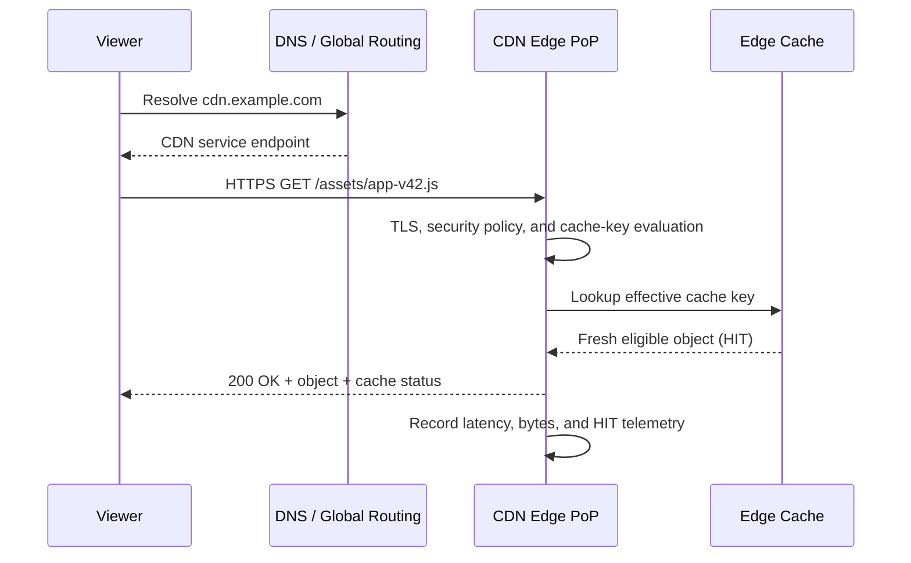
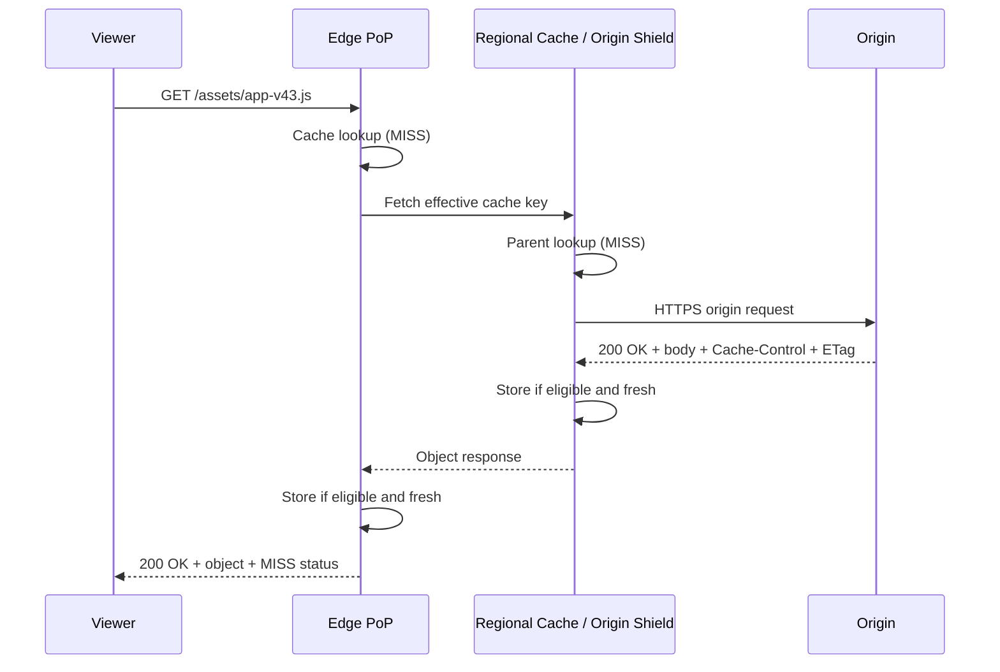
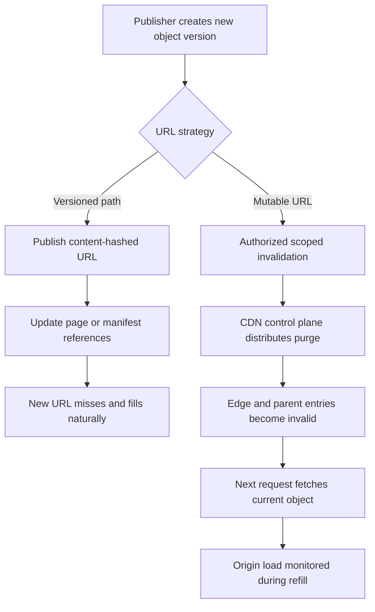
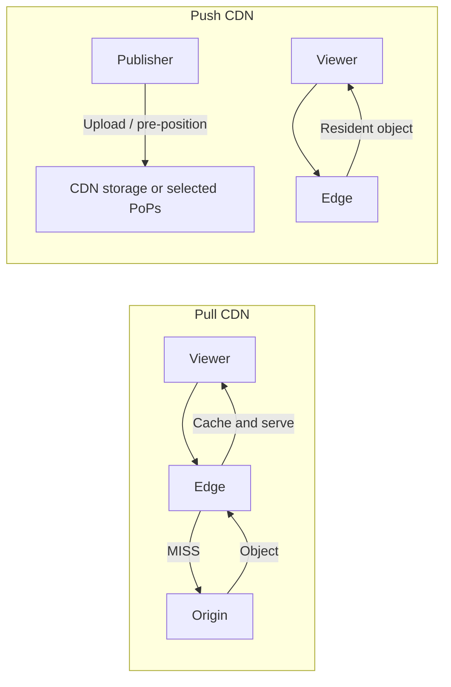
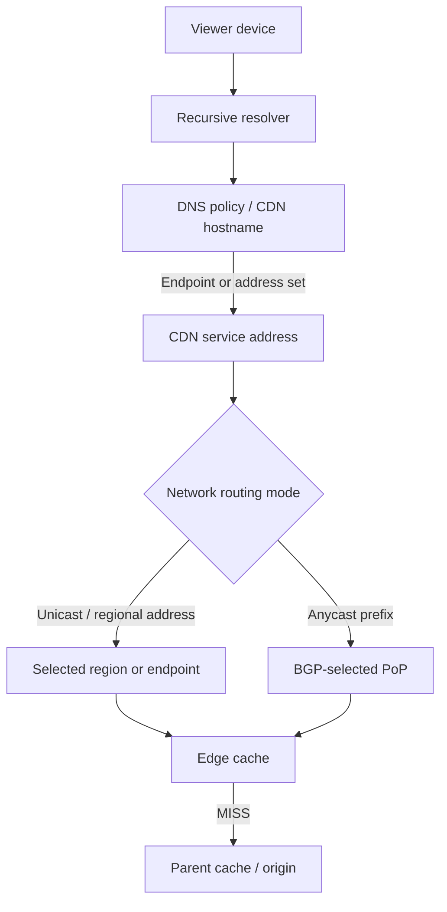
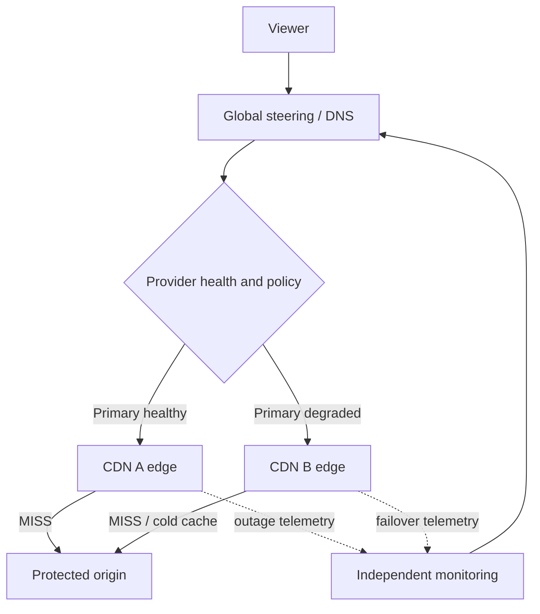
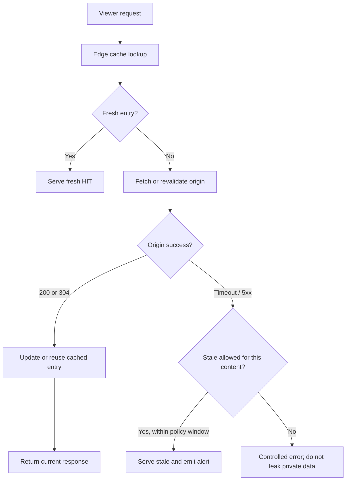

# CS-008 — Data Flow Specification

## Flow 1: Cache HIT



The edge can serve a HIT without an origin body fetch only when the stored entry is fresh and the request is eligible under the configured authorization and cache policy.

## Flow 2: Cache MISS through an origin shield



If the parent cache has the object, the origin request is skipped and the edge can fill from the parent. Products may report cache statuses differently; a parent hit is not necessarily an edge HIT.

## Flow 3: Conditional revalidation

```mermaid
sequenceDiagram
    participant V as Viewer
    participant E as CDN Edge
    participant O as Origin

    V->>E: GET /news/latest.html
    E->>E: Entry exists but is stale; has ETag
    E->>O: GET + If-None-Match: "edition-42"
    alt Object unchanged
        O-->>E: 304 Not Modified + updated metadata
        E->>E: Refresh freshness metadata, reuse stored body
        E-->>V: 200 OK + cached body
    else Object changed
        O-->>E: 200 OK + new body + ETag "edition-43"
        E->>E: Replace cached representation
        E-->>V: 200 OK + new body
    end
```

A 304 response saves body transfer but still requires an origin round trip. It is not the same as a fresh edge HIT.

## Flow 4: Purge and versioned publication



Purge completion and propagation are provider-specific. Browser and intermediary caches may retain an already downloaded object according to their own policy; versioned URLs provide stronger rollout and rollback control.

## Flow 5: Push versus pull



Pull avoids pushing unused objects but has a cold first request. Push controls placement for planned content but requires publication and replication workflows; it does not imply synchronous population of every edge.

## Flow 6: DNS steering and anycast



DNS policy may use resolver location and configured health/latency information. Anycast routing follows network path selection. Neither should be described as guaranteed selection of the physically nearest or least-loaded edge.

## Flow 7: Multi-CDN failure handling



Failover can create cache refill and extra origin traffic. Provider health should be measured independently of the control channel used to change DNS, and the alternate CDN must already have valid certificates, origin access, cache rules, and authorization behavior.

## Flow 8: Origin failure and stale response policy



Stale serving is a content policy, not a universal fallback. A cache must not serve stale private, revoked, or security-sensitive content outside its authorization and freshness rules.

## Error and edge-case paths

- Cache bypass: only bypass for explicitly configured method, authorization, cookie, or request policy.
- Cache key collision: treat as a security/correctness incident, disable the faulty behavior, purge affected objects, and assess exposure.
- No origin or parent available: serve stale only if policy permits and content is safe; otherwise return a controlled error.
- Conditional origin fetch times out: follow stale-if-error policy if applicable; emit origin timeout and stale-serving metrics.
- Purge delayed: publish versioned URLs and communicate that browser/intermediary copies may persist.
- Signed URL expired or invalid: reject before delivering restricted content, including when a body is cached.
- DNS/anycast route changes: account for cached DNS answers, established connections, and route convergence.
- Origin failure: stop or limit retries, keep safe stale content available when allowed, and alert on origin health.
- Partial object/range request: apply range and cache semantics consistently; do not combine incompatible byte ranges.
