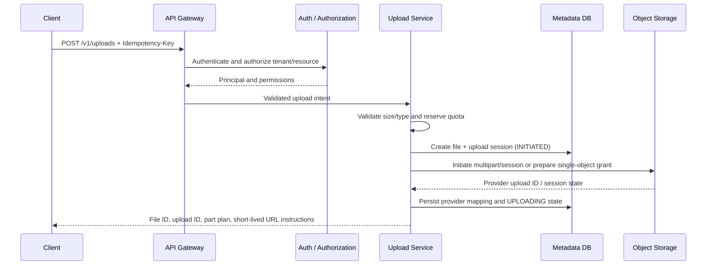
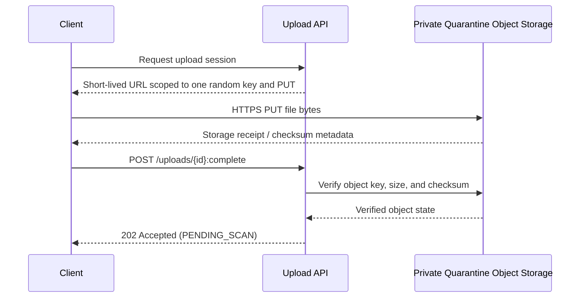
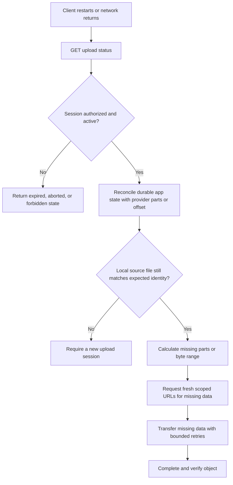
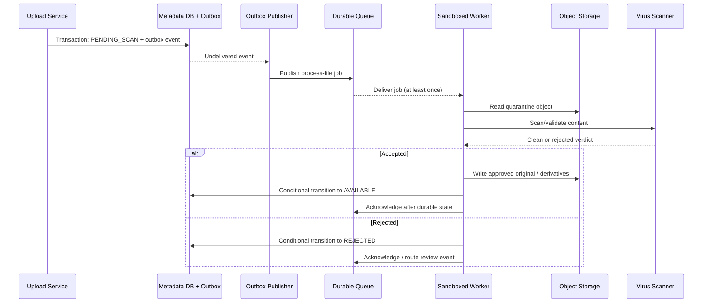
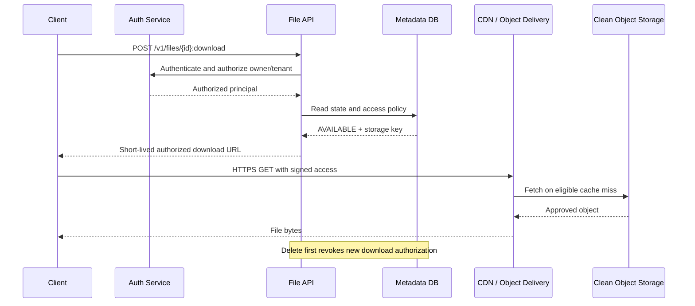
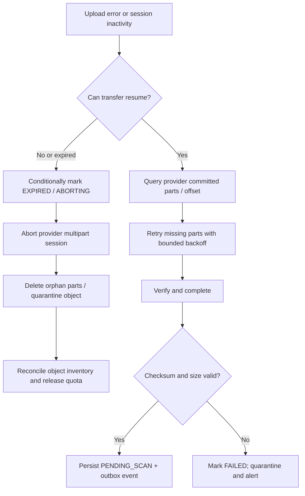

# CS-009 — Data Flow Specification

## Flow 1: Initiate and authorize upload



The application returns transfer credentials only after durable metadata and session state exist. Provider upload IDs and signed URLs are secrets and must not be written to ordinary logs.

## Flow 2: Direct single-object upload



The file is not downloadable merely because object storage accepted a PUT. The upload API verifies the expected object and moves it to the processing workflow.

## Flow 3: Multipart upload and retry

```mermaid
sequenceDiagram
    participant C as Client
    participant U as Upload API
    participant O as Object Storage
    participant M as Metadata DB

    C->>U: Request signed URLs for parts 1..N
    U->>M: Verify owner/session and part range
    U-->>C: Short-lived URLs for allowed parts
    par Bounded parallel transfer
        C->>O: PUT part 1
        O-->>C: Part ETag / checksum
    and
        C->>O: PUT part 2
        O-->>C: Part ETag / checksum
    end
    Note over C,O: Connection drops while part 3 is incomplete
    C->>U: GET upload progress
    U->>O: Reconcile provider part list / offset
    O-->>U: Parts 1 and 2 committed
    U-->>C: Missing part 3; request a fresh URL
    C->>O: Retry only part 3
    O-->>C: Part 3 receipt
    C->>U: POST complete with part manifest + checksum
    U->>O: Complete multipart upload
    O-->>U: Final object metadata
    U->>M: Verify and transition to PENDING_SCAN
```

The per-part manifest and ETag requirements are storage-provider-specific. A full-object checksum must use a supported, explicitly selected checksum algorithm; multipart ETags are not universally a full-file digest.

## Flow 4: Resume after client restart



The server is authoritative for committed storage state; client progress indicators alone are not proof that a part was durably stored.

## Flow 5: Outbox, queue, scan, and publish



Outbox publication and worker delivery can repeat. The worker must be idempotent and verify the current file state and object key before committing results.

## Flow 6: Authorized download and deletion



Deletion must revoke access before asynchronous object and derivative cleanup. Cached copies and replication have provider-specific invalidation/deletion behavior and should be included in the retention policy.

## Flow 7: Failure recovery and cleanup



Cleanup should be idempotent and observable. If storage is unavailable, the session remains in a retryable cleanup state rather than being recorded as successfully deleted.

## Error and edge-case paths

- Initiation response is lost: retry with the same idempotency key and receive the existing session.
- Signed URL expires: authenticate again and request a replacement for a missing part; do not broaden the grant.
- Part response is lost: reconcile the provider's committed-part list before re-uploading.
- Completion races: use a per-session lock or conditional state/version update; only one logical completion proceeds.
- Storage completes but DB is unavailable: reconcile by random object key/session ID before retrying or cleaning up.
- Outbox or queue unavailable: retain undelivered outbox rows and keep the file unavailable until processing is durably scheduled.
- Duplicate queue event: verify file state and deterministic job/output identity before work or state transition.
- Scanner unavailable: preserve quarantine state and apply backpressure; do not bypass required validation.
- Delete arrives during an upload: revoke future URL issuance, abort session, and clean late-arriving object parts.
