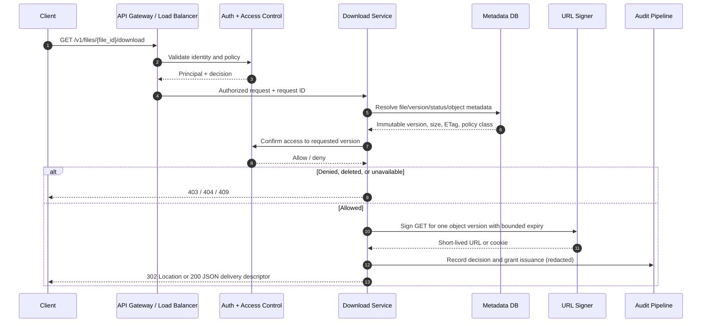
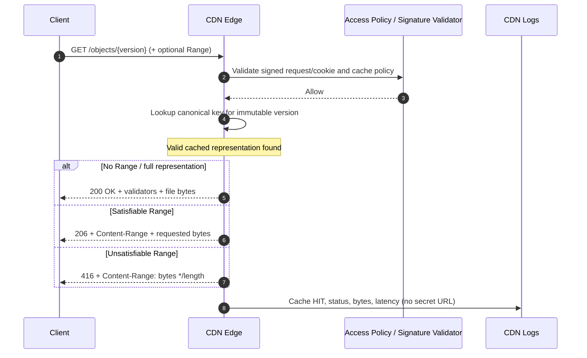
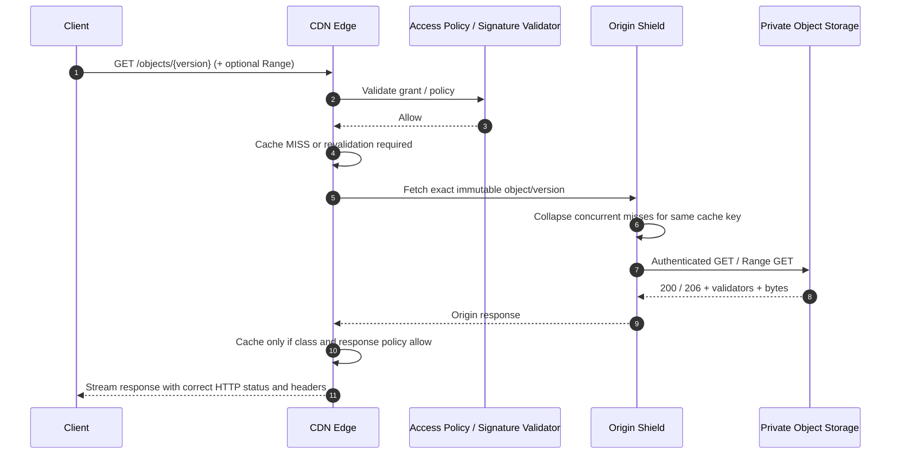
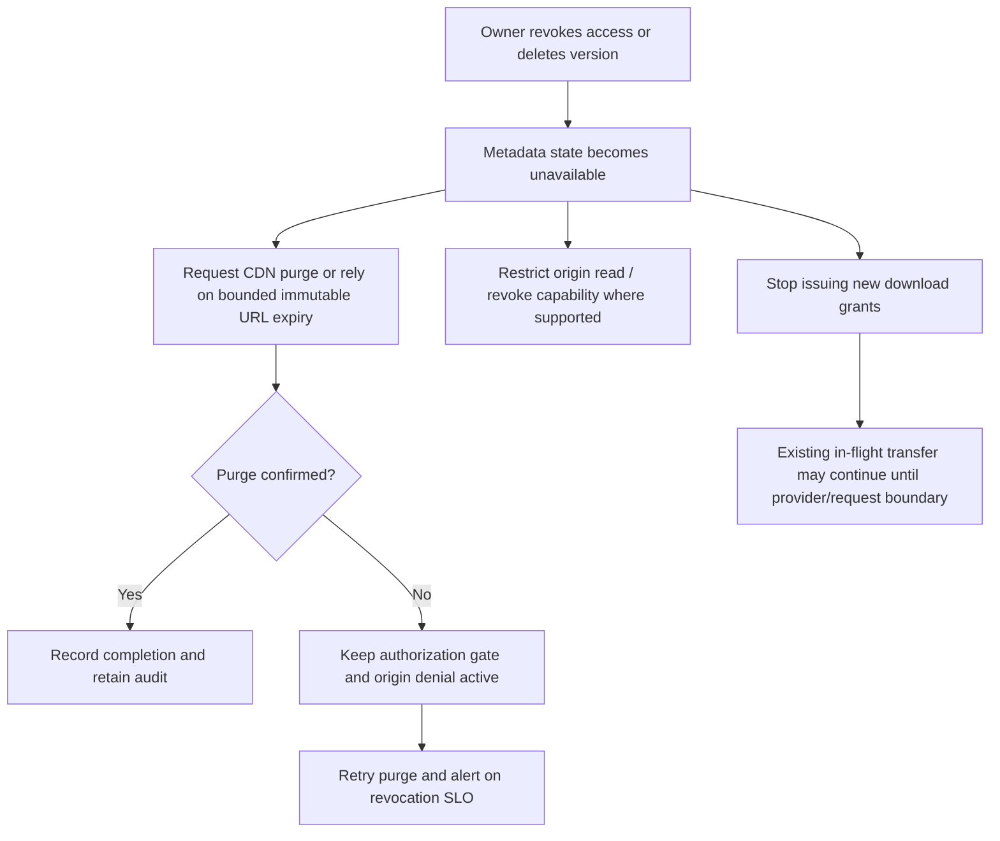

# CS-010 — File Download Service Data Flows

These flows describe a proposed design. Provider-specific URL, range, cache, and revocation semantics must be confirmed against the selected service.

## Authorized download and URL issuance



## CDN cache HIT



## CDN cache MISS and origin shield



## Safe range resume after interruption

```mermaid
sequenceDiagram
    autonumber
    participant C as Client
    participant E as CDN / Delivery Endpoint
    participant O as Origin

    C->>E: Initial GET
    E->>O: GET immutable object
    O-->>E: 200 + ETag "v17" + Content-Length
    E-->>C: 200 + ETag "v17" + bytes
    Note over C: Connection interrupted; persist local length N and ETag
    C->>E: GET + Range: bytes=N- + If-Range: "v17"
    E->>O: Range GET with validator (cache miss)
    alt Validator still matches
        O-->>E: 206 + Content-Range: bytes N-(L-1)/L + ETag "v17"
        E-->>C: 206 + matching Content-Range and remaining bytes
        Note over C: Append only after validating offset, total length, and ETag
    else Object version changed
        O-->>E: 200 full current representation
        E-->>C: 200 full body; client replaces/restarts partial file
    else Range cannot be satisfied
        O-->>E: 416 + Content-Range: bytes */L
        E-->>C: 416; client reconciles local offset or restarts
    end
```

## Revocation and cache purge



## Notes

- The client appends a partial response only if the requested start offset, `Content-Range`, total length, and validator agree with its saved state.
- A CDN cache hit must still validate a private-content grant or use a correctly scoped signed capability.
- CDN purge completion and URL expiry are not universal instantaneous revocation mechanisms.
- Log object/file/version IDs and decisions, but redact signed URL query strings, cookies, credentials, and authorization headers.
