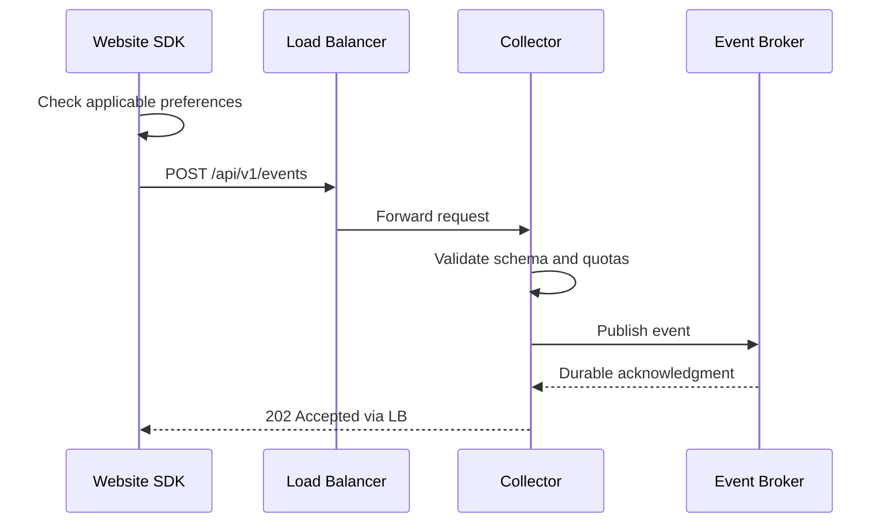
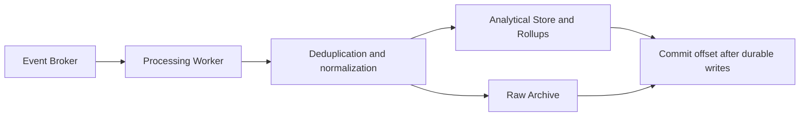
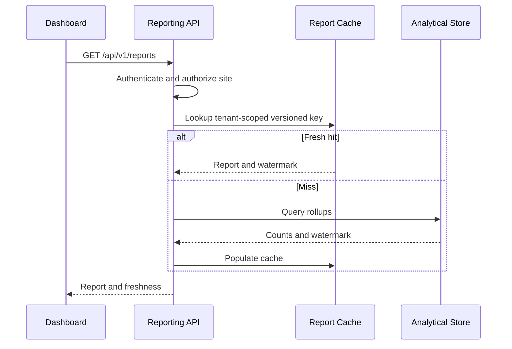

# CS-012 — Data Flow Specification

## Flow 1: Collect event

## Flow 2: Process events

## Flow 3: Generate report

## Error and edge-case paths
- Invalid event: 400; oversized payload: 413; quota exceeded: 429.
- Broker unavailable: 503; retry with same event ID.
- Duplicate delivery: idempotent writes and rollups.
- Late event: correct affected window and version cached reports.
- Unauthorized report: 401 or 403; store unavailable: controlled 503 or explicitly stale authorized result.
- Worker commits offsets only after required durable writes succeed.
