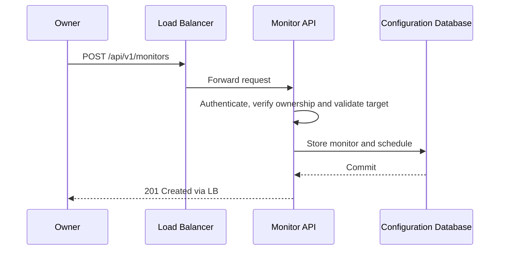
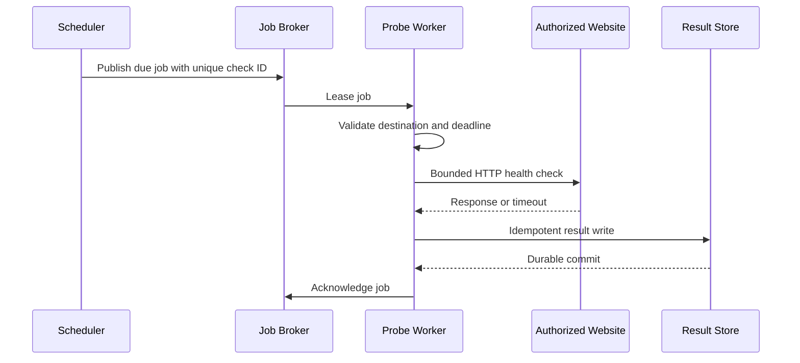
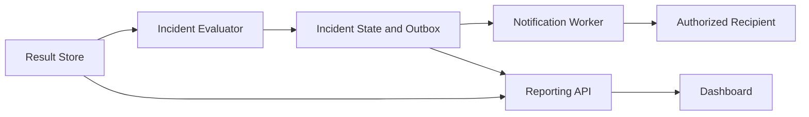

# CS-013 — Data Flow Specification

## Flow 1: Register monitor

## Flow 2: Execute scheduled check

## Flow 3: Incident and reporting

## Error and edge-case paths
- Invalid or unauthorized target: reject registration; enforce destination policy at execution.
- Duplicate job: unique check ID prevents duplicate result and incident evaluation.
- Probe timeout: record failed observation; infrastructure failure or missed schedule: unknown.
- Store unavailable: do not acknowledge job; retry within deadline or record unknown after recovery.
- Late results: retain for audit; evaluate ordered slots using a bounded lateness policy.
- Notification failure: retry with bounded backoff and transition ID; alert operators on exhausted retries.
