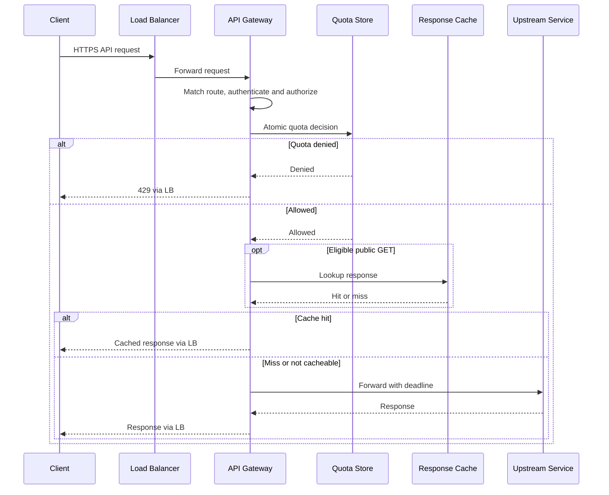
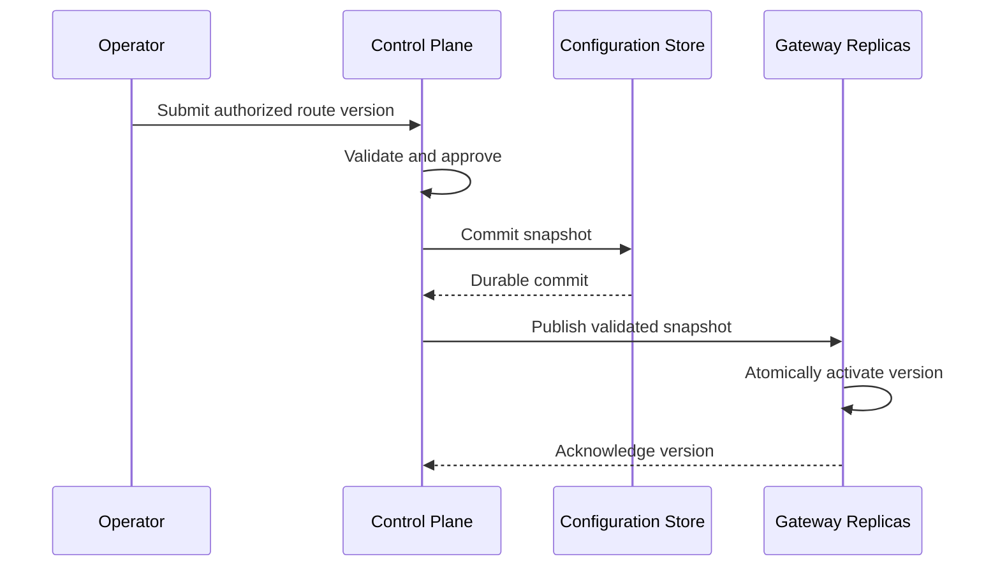
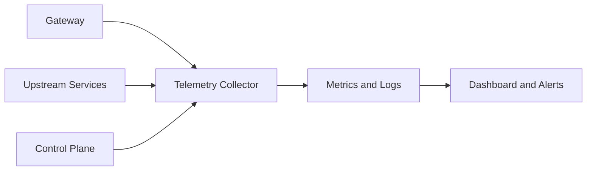

# CS-014 — Data Flow Specification

## Flow 1: Route API request

## Flow 2: Publish configuration

## Flow 3: Observability

## Error and edge-case paths
- Unknown route: 404; invalid credentials: 401; insufficient permission: 403.
- Exhausted quota: 429; quota dependency unavailable: 503, fail closed.
- Upstream connection failure: 502 or 503 according to policy; deadline exceeded: 504.
- Cache unavailable: bypass with upstream capacity protection.
- Invalid configuration: reject update and retain last valid version.
- Never automatically retry non-idempotent operations without an explicit safe contract.
