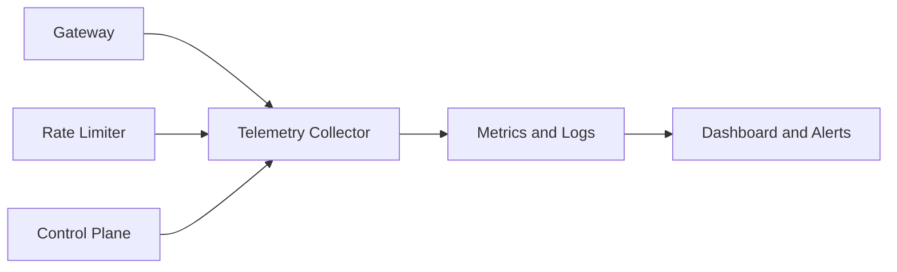

# CS-015 — Data Flow Specification

## Flow 1: Enforce API request
```mermaid
sequenceDiagram
 participant C as Client
 participant LB as Load Balancer
 participant G as Gateway
 participant R as Rate Limiter
 participant S as Bucket State Store
 participant U as Protected API
 C->>LB: HTTPS request
 LB->>G: Forward request
 G->>G: Authenticate and authorize; derive trusted key
 G->>R: Check policy and key
 R->>S: Atomic refill and consume
 alt Allowed
 S-->>R: Allowed
 R-->>G: Allow
 G->>U: Forward request
 U-->>G: Response
 G-->>C: Response via LB
 else Exhausted
 S-->>R: Denied
 R-->>G: Deny and retry estimate
 G-->>C: 429 via LB
 else State unavailable
 S-->>R: Error or timeout
 R-->>G: Unavailable
 G-->>C: 503 via LB
 end
```

## Flow 2: Publish configuration
```mermaid
sequenceDiagram
 participant O as Operator
 participant P as Control Plane
 participant D as Policy Store
 participant R as Decision Workers
 O->>P: Submit authorized policy version
 P->>P: Validate and approve
 P->>D: Commit snapshot
 D-->>P: Durable commit
 P->>R: Publish validated snapshot
 R->>R: Activate version; migrate bucket on next decision
 R-->>P: Acknowledge version
```

## Flow 3: Observability


## Error and edge-case paths
- Invalid credentials: 401; insufficient permission: 403; unknown route: 404.
- Exhausted bucket: 429; state unavailable or uncertain: 503, fail closed.
- Retry-After is an estimate, not a reservation.
- Invalid policy: reject and retain last valid version within freshness policy.
- On policy change, clamp existing tokens; never grant a new burst merely because a version changed.
- Do not automatically retry an ambiguous token consumption; return controlled error.
