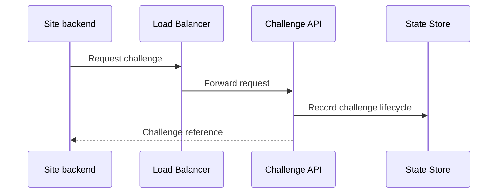
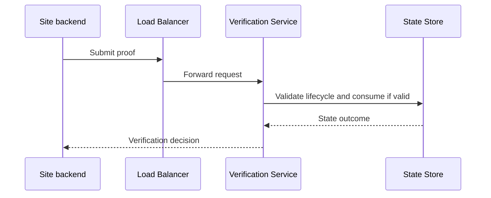
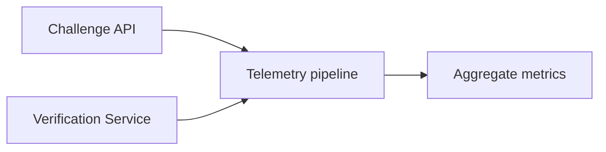

# CS-016 — Data Flow Specification

## Flow 1: Challenge issuance

## Flow 2: Verification

## Flow 3: Telemetry

## Error and edge-case paths
- Expired or consumed proof: reject and offer fresh verification.
- State unavailable: controlled unavailable response; no positive decision.
- Telemetry unavailable: bounded buffering and alerting.
- Accessibility issue: offer alternative verification or recovery.
