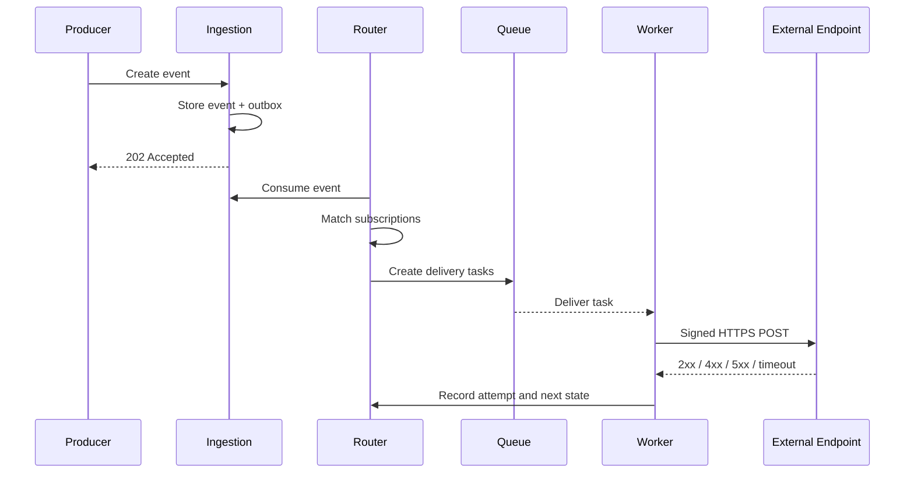

# CS-019 — Design a Webhook Delivery Platform

> **Content status:** Educational reference design. This document proposes a generic webhook delivery platform and does not claim to describe a named company's private architecture. Workload, latency, retry, and availability values are illustrative assumptions.
>
> **Source alignment:** The assigned catalogue identifies this as Case 19 in Category A: Web & Internet Systems. The required structure follows the repository's 18-section case-study template.

## A. Basic information

| Field | Value |
|---|---|
| Case Study ID | CS-019 |
| System name | Webhook Delivery Platform |
| Real-world reference | Stripe, GitHub, Shopify, and subscription platforms use webhook patterns; this is not an asserted implementation of any named provider |
| Category | Web & Internet Systems |
| Category number | A |
| Case number | 19 |
| Difficulty | Intermediate |
| Short description | A reliable event-to-external-HTTP platform that registers endpoints, routes subscriptions, signs requests, retries transient failures, records delivery status, and supports replay and endpoint health management. |
| Primary users | Platform applications, customer integrators, tenant administrators, reliability and trust operators |
| Key concepts | Event ingestion, subscriptions, at-least-once delivery, HMAC signatures, retries, jitter, DLQ, circuit breakers, idempotency, SSRF protection |
| Related component IDs | CMP-001 (Load Balancer) |
| Research status | Draft reference content |
| Researcher | To be assigned |
| Reviewer | To be assigned |
| Last updated | 2026-11-20 |

### Scope and assumptions

- The platform accepts durable business events and routes each event to subscribed endpoints according to event type and filters.
- Delivery is asynchronous, HTTP-based, tenant-isolated, and uses at-least-once semantics.
- Consumers must process duplicate events safely using the event ID and/or an idempotency key.
- Events, subscriptions, attempts, and logs are stored durably. Payload retention is policy-bounded.
- External endpoints are untrusted. TLS, SSRF controls, redirects, timeouts, response limits, and rate limits apply.
- Retry schedules are configurable, but permanent `4xx` responses and policy-rejected endpoints do not automatically retry.
- All throughput, latency, and retention values are assumptions.

---

## 01 — Story

A payment service completes a charge and must notify a merchant that `payment.succeeded`. The merchant may receive the event on a URL behind a slowly changing network. It may be temporarily unavailable, process the request slowly, or receive the same event more than once.

A webhook delivery platform separates event generation from external delivery. The provider durably stores an event, finds matching subscriptions, creates delivery tasks, and invokes each endpoint through isolated workers. Workers sign each request, interpret HTTP responses, schedule retries, maintain audit history, and move permanently failed deliveries to a recoverable dead-letter state.

### Actors

1. **Event producer:** Publishes a business event after a durable state transition.
2. **Webhook customer:** Registers an endpoint, subscribes to event types, and verifies signatures.
3. **API Gateway/load balancer:** Terminates TLS, authenticates, routes, and applies tenant limits.
4. **Webhook management service:** Handles endpoints, subscriptions, validation, verification, secrets, and replay.
5. **Event ingestion service:** Validates and durably stores events.
6. **Event router:** Matches event type/filters and creates delivery tasks.
7. **Message queue:** Buffers events and per-endpoint delivery tasks.
8. **Delivery scheduler:** Applies delayed retry, priority, fairness, and endpoint limits.
9. **Delivery workers:** Construct requests, sign payloads, send HTTPS requests, and record results.
10. **Retry manager/DLQ:** Schedules retries or retains poison/permanently failed deliveries.
11. **Databases/cache:** Store durable event, endpoint, subscription, delivery, retry, and status state.
12. **Monitoring service:** Tracks platform and endpoint health.

### Core user journey

1. Business service records a payment success and produces `payment.succeeded`.
2. Event service validates tenant/type/payload and stores event `evt_01J...`.
3. Event is published durably to the event stream or queue.
4. Router finds active subscriptions whose filters match.
5. Router creates one delivery task per endpoint.
6. Scheduler places tasks into partitioned or delayed queue lanes.
7. Worker obtains a signing secret for the endpoint and generates an HMAC signature.
8. Worker sends `POST` to the registered HTTPS URL with event metadata.
9. Worker records status code, duration, bounded response metadata, and attempt number.
10. `2xx` marks success; retryable failure schedules backoff; permanent failure stops or moves to DLQ.
11. Customer inspects history or replays a failed delivery.
12. Endpoint heartbeat/verification and circuit-breaker state are updated.

### Problem boundaries

This design covers event durability, subscription routing, endpoint delivery, retry/replay, security, observability, and high availability. It does not implement a specific consumer application, payment domain, transport protocol beyond HTTP, or third-party endpoint infrastructure.

---

## 02 — Requirements

### Functional requirements

| ID | Requirement |
|---|---|
| FR-01 | Register, verify, update, deactivate, and delete webhook endpoints |
| FR-02 | Subscribe endpoints to event types with optional filters |
| FR-03 | Generate or ingest business events with a tenant and unique event ID |
| FR-04 | Route events to matching active subscriptions |
| FR-05 | Deliver JSON events over signed HTTP(S) requests |
| FR-06 | Maintain attempt, status, response, and retry history |
| FR-07 | Retry transient failures using configurable bounded policies |
| FR-08 | Replay failed or historical events |
| FR-09 | Support circuit breakers and endpoint health state |
| FR-10 | Notify customers of persistent failures or endpoint disablement |
| FR-11 | Provide endpoint verification and webhook testing |
| FR-12 | Provide delivery/admin APIs and tenant-scoped audit records |

### Non-functional requirements

| ID | Requirement | Initial target |
|---|---|---|
| NFR-01 | Event durability | No acknowledged event loss except policy deletion or disaster beyond RPO |
| NFR-02 | Delivery guarantee | At-least-once; exactly-once delivery is not guaranteed |
| NFR-03 | API availability | Illustrative 99.95% monthly |
| NFR-04 | Low latency | Illustrative 99% of simple deliveries queued within 5 seconds |
| NFR-05 | Horizontal scaling | API, router, scheduler, and workers scale independently |
| NFR-06 | Security | HTTPS, HMAC signatures, timestamp checks, SSRF protection, tenant isolation |
| NFR-07 | Backpressure | Queue and worker capacity degrade gracefully |
| NFR-08 | Observability | Delivery, retry, queue, endpoint, and tenant metrics |
| NFR-09 | Idempotency | Event ID and delivery attempt identity avoid accidental duplicate task creation |
| NFR-10 | Regional recovery | RPO/RTO are measured and documented per selected deployment |

### Out of scope

Consumer business-idempotency implementation, webhook protocol beyond HTTPS, push subscriptions over proprietary protocols, and exact provider internal architecture.

---

## 03 — Scale

### Workload assumptions

| Input | Assumption |
|---|---:|
| Business events/day | 10,000,000 |
| Average subscriptions/event | 3 |
| Delivery tasks/day | 30,000,000 |
| Average payload | 10 KiB |
| Initial delivery success | 95% |
| Retry share | 5% of initial tasks |
| Average delivery timeout | 10 seconds |
| Peak-to-average factor | 10× |
| Average payload/day | ≈ 279 GiB before replication |

Average delivery-task rate is approximately `30,000,000 / 86,400 ≈ 347` tasks/second. A 10× peak is approximately 3,470 tasks/second, excluding retries. With an average 10-second timeout and 95% workers receiving success quickly, 4,000 concurrent requests is a sample planning constraint, not a guaranteed capacity.

Scale for event fan-out, payload storage, queue partitions, HTTP sockets, DNS, signing CPU, database writes, retry scheduling, logs, tenant fairness, and endpoint-specific limits.

### Questions for production sizing

- What is payload size distribution and retention?
- How many subscriptions and tenants share an event?
- What retry window and endpoint rates are required?
- Are ordering guarantees required per endpoint or only delivery completion?
- What RPO/RTO applies to event, attempt, and replay state?
- How are bulk replay and customer export handled?

---

## 04 — Naive Architecture

### Simplest viable design

An application receives a business operation, sends an HTTP request to every registered endpoint, waits for response, and retries in the same server.

**Components**
- Event producer
- One application server
- Webhook endpoints
- Local database

**Request flow**
1. Producer calls webhook application.
2. Application finds endpoints.
3. Application sends HTTP requests synchronously.
4. Application logs success/failure.

### Naive architecture diagram

See `architecture.png`.

### Why begin here?

The design demonstrates end-to-end delivery but couples business traffic to external availability, loses work on process failure, cannot scale endpoint-specific retries fairly, and has no durable delivery history or replay.

---

## 05 — Problems

| Problem | Impact | Improvement |
|---|---|---|
| External endpoint unavailable | Delivery blocks or fails | Queue, worker retry, and backpressure |
| Slow endpoint | Worker/socket exhaustion | Timeout and bounded concurrency |
| Worker crash | Task acknowledgment lost | Visibility timeout and at-least-once redelivery |
| Duplicate delivery | Consumer side effects | Event ID/idempotency guidance |
| Thundering retry herd | Sudden endpoint load | Exponential backoff and jitter |
| SSRF endpoint | Internal infrastructure access | URL/DNS/IP/redirect validation |
| Secret exposure | Forged webhook events | Secret manager and redacted logs |
| Replay attack | Old event reused | Timestamp and signature validation |
| Hot tenant | Cross-tenant impact | Tenant fairness and quotas |
| Queue poison | Worker crash loop | Retry limit, DLQ, and quarantine |
| Ordering assumption | Consumer expects impossible sequence | Explicit per-endpoint sequence policy |
| Permanent 4xx | Wasteful retries | Stop and classify permanent failure |
| Missing 3xx policy | Credential leakage/redirect loop | Revalidate redirect target; do not forward secrets |
| Delivery log growth | Cost/query latency | Partition/archive old logs |
| Replay storm | External endpoint overload | Replay rate limits and audit |

---

## 06 — Architecture Evolution

### V1 — Durable event and synchronous delivery

Store event and attempt, then call endpoints synchronously. This preserves a basic result but couples availability.

### V2 — Queue and delivery workers

Publish a durable event task to a queue and acknowledge after bounded HTTP completion or scheduling retry. Worker scaling becomes independent.

### V3 — Subscription routing

Separate event ingestion from router. Router matches event type and filters and creates endpoint-specific delivery tasks.

### V4 — Retry, scheduler, and DLQ

Store next retry time and attempt number. Retry transient failures with jitter. Permanently failed tasks move to a recoverable DLQ.

### V5 — Security and endpoint health

Sign requests with HMAC, validate timestamps, manage secrets, verify ownership, block unsafe targets, and maintain circuit-breaker state.

### V6 — Fair scaling and regional resilience

Partition queue tasks, shard databases, apply token-bucket limits, isolate tenant workload, replicate event storage, and deploy workers across zones.

### Proposed evolved architecture

1. Producer calls event ingestion or writes through an outbox.
2. Event is validated, assigned an event ID, stored durably, and published.
3. Router loads active subscriptions and applies event-type/field filters.
4. Router creates one delivery task per endpoint and stores a delivery record.
5. Queue partitions delivery tasks by tenant/endpoint or stable key.
6. Scheduler applies normal, delayed, priority, or retry delivery lanes.
7. Worker constructs payload and signature headers.
8. Worker validates destination and sends HTTPS request with timeout and size limits.
9. Worker records response/latency/error and schedules retry or success.
10. Retry manager, DLQ, replay API, and circuit breaker consume delivery state.

### Event lifecycle

**Generation**
- Business operation occurs.
- Event receives UUID/ULID and schema version.
- Event is durably stored and published.

**Routing**
- Match event type.
- Apply subscription filters.
- Resolve active endpoints.
- Deduplicate endpoint/task using `(event_id, endpoint_id, subscription_id)`.

**Delivery**
- Construct canonical payload and metadata.
- Sign a timestamp, event ID, and exact body.
- Send HTTPS with bounded response.
- Record attempt and delivery state.

**Confirmation**
- `2xx`: success.
- `3xx`: configured redirect policy only; normally do not forward bearer secrets or credentials.
- `4xx`: permanent or customer configuration; classify selected codes for retry.
- `5xx`: retryable; account for endpoint recovery.
- Timeout/DNS/network errors: retryable based on policy.

### Retry schedule

Example exponential schedule:

| Attempt | Delay |
|---|---:|
| 1 | 0 s |
| 2 | 30 s |
| 3 | 2 min |
| 4 | 10 min |
| 5 | 1 hour |
| 6 | 6 hours |
| 7 | 24 hours |

Jitter adds a bounded random factor to avoid synchronized retry storms. Maximum attempts and window are endpoint configurable within platform bounds. Permanent `401/403/410` and payload validation failures may stop or require customer correction.

### Circuit breaker

- **Closed:** normal calls; count failures.
- **Open:** reject/delay calls for cooldown after threshold.
- **Half-open:** allow limited probes; close after recovery or reopen after failure.

### Database model

| Table | Key fields |
|---|---|
| webhook_endpoints | endpoint_id, customer_id, endpoint_url, status, signing_secret_reference, created_at, updated_at |
| event_subscriptions | subscription_id, customer_id, endpoint_id, event_type, filter_config, status |
| events | event_id, event_type, payload_reference, tenant_id, schema_version, created_at |
| deliveries | delivery_id, event_id, endpoint_id, status, attempt_count, next_retry_at, circuit_state |
| delivery_attempts | attempt_id, delivery_id, attempt_number, status_code, response_body_reference, error, duration, timestamps |
| delivery_logs | log_id, delivery_id, request_timestamp, response_timestamp, bounded_error, trace_id |

Use foreign keys where practical, tenant indexes, and partition attempts/logs by tenant/time. Keep large payloads in object storage and retain only references or bounded preview fields in the relational database.

### HMAC signature design

Recommended header fields:

```text
X-Webhook-ID: evt_01J...
X-Webhook-Timestamp: 1732104000
X-Webhook-Signature: v1=<hex_hmac_sha256>
Idempotency-Key: evt_01J...
```

Signature over a documented canonical string, for example:

`timestamp + "." + exact_request_body`

Consumers reject stale timestamps and recompute HMAC with constant-time comparison. Signature and timestamp alone do not make payload safe; consumers should validate schema and origin policy.

### API design

#### Register endpoint

`POST /api/v1/webhooks/endpoints`

```json
{
  "url": "https://merchant.example/webhooks/payment",
  "description": "Payments",
  "status": "PENDING_VERIFICATION"
}
```

`201 Created` returns endpoint ID, verification challenge metadata, and no plaintext signing secret after initial disclosure.

#### Subscribe

`POST /api/v1/webhooks/subscriptions`

```json
{
  "endpoint_id": "wh_01J...",
  "event_type": "payment.succeeded",
  "filter": {
    "field": "currency",
    "operator": "equals",
    "value": "USD"
  }
}
```

`201 Created`.

#### Delivery history

`GET /api/v1/webhooks/deliveries?event_id=evt_01J...&status=FAILED`

Returns delivery IDs, attempt count, endpoint, status, next retry, and timestamps.

#### Replay

`POST /api/v1/webhooks/deliveries/{deliveryId}/replay`

```json
{
  "reason": "consumer recovered",
  "new_attempt_window": "2026-11-20T14:00:00Z"
}
```

Replay creates a new delivery generation/attempt and preserves the original event ID. It is audited and rate-limited.

#### Endpoint status codes

`200` retrieval/update, `201` registration/subscription, `202` replay/test accepted, `400` malformed input, `401/403` auth, `404` hidden/missing resource, `409` state conflict, `422` unsupported filter/verification, `429` quota/rate limit, `503` temporary dependency failure.

---

## 07 — Components

| Component ID | Component | Responsibility |
|---|---|---|
| CMP-001 | Load Balancer | Distributes API/router/worker control traffic |
| TBD | API Gateway | TLS, auth, routing, tenant and endpoint limits |
| TBD | Authentication/Authorization | Tenant, customer, endpoint, and replay permissions |
| TBD | Webhook Management | Endpoint/subscription lifecycle and verification |
| TBD | Event Ingestion | Validate and durably store events |
| TBD | Event Router | Match subscriptions/filters and create tasks |
| TBD | Event DB | Durable event and event metadata |
| TBD | Subscription DB | Endpoints and subscriptions |
| TBD | Delivery DB | Delivery state, attempts, next retry |
| TBD | Queue | Persist event/delivery tasks |
| TBD | Scheduler | Delayed and retry scheduling |
| TBD | Delivery Workers | HTTP delivery, signing, and recording |
| TBD | Retry Manager | Backoff, circuit state, retry limit |
| TBD | DLQ | Failed/poison delivery recovery |
| TBD | Signature Service | Secret retrieval and canonical signing |
| TBD | Redis | Lock, circuit state, cache, and endpoint limit state |
| TBD | Monitoring/Audit | Metrics, structured logs, trace, customer dashboard |

### Component interactions

- Producer → ingestion → event DB/outbox → queue/router.
- Router → subscription DB/Redis → delivery DB → queue.
- Worker → endpoint verification/secret store → external HTTPS endpoint.
- Worker → delivery DB/queue/retry/DLQ → status API.
- Replay API → delivery DB → queue with original event identity.
- Monitoring → metrics/dashboard/alerting and customer delivery views.

---

## 08 — Data Flow

### Flow A: Event generation

1. Producer completes business state change.
2. Producer sends event with tenant/type/payload/idempotency key.
3. Ingestion validates schema and authorization.
4. Event DB/outbox atomically records event and publication record.
5. Publisher sends event to queue/stream and retries publication safely.

### Flow B: Routing

1. Router consumes event.
2. It loads active subscriptions for tenant/type.
3. Each filter is evaluated.
4. Endpoint status/verification is checked.
5. Delivery task is deduplicated and persisted.
6. Scheduler queues it with endpoint/tenant priority.

### Flow C: Delivery

1. Worker obtains task and verifies lease.
2. Worker loads endpoint metadata and signing secret.
3. Worker reconstructs exact payload and signed headers.
4. Worker performs SSRF/DNS/redirect checks.
5. HTTPS request is sent with timeout and response limits.
6. Worker records status/duration/error.
7. Delivery becomes success, retry scheduled, permanent failure, or DLQ.

### Flow D: Replay

1. Customer selects failed delivery.
2. Authorization and replay limits are checked.
3. Platform creates a replay task tied to original event.
4. Queue delivers the original event identity/signature generation time.
5. Consumer receives duplicate event by design and must deduplicate.

### Sequence



---

## 09 — Failure Scenarios

| Failure | Detection | Recovery |
|---|---|---|
| Database failure | Transaction/health error | Fail closed for mutation; outbox/reconciliation after recovery |
| Queue outage | Publish/lag/consume error | Durable event and outbox retry; backpressure |
| Worker crash | Visibility timeout | Redeliver task; at-least-once duplicate |
| Endpoint timeout | HTTP deadline | Retryable failure plus jitter |
| DNS failure | Resolver error | Retry; circuit/endpoint health |
| Endpoint 5xx | Status code | Retry schedule |
| Endpoint 410/invalid auth | Permanent response | Stop retry, notify customer, optionally disable |
| Redirect loop/unsafe target | Redirect validator | Fail delivery; no secret forwarding |
| Secret unavailable | Secret store error | Temporarily stop endpoint task; retry; alert |
| Hot tenant | Tenant queue/latency metrics | Fair queue and tenant quota |
| Poison payload | Repeated parser/schema failure | DLQ after bounded attempts |
| Replay storm | Replay rate | Queue/workflow rate limit |
| Regional outage | Regional health | Replicated control/queue/event failover |

Retries are bounded and jittered. Permanent `4xx` classifications are endpoint-policy configurable, not universally assumed.

---

## 10 — Scaling

- Horizontally scale ingestion, router, scheduler, and workers.
- Partition event/delivery queues by tenant and stable hash.
- Use separate pools for normal delivery, slow endpoints, retry, replay, and DLQ.
- Index delivery records by event, endpoint, status, and next retry.
- Shard by tenant only after measured tenant concentration.
- Cache endpoint status/secrets with short TTL and explicit invalidation.
- Batch database writes and delivery metrics only after durable delivery state.
- Apply token/leaky bucket per endpoint and tenant.
- Archive old attempts/logs and export payload history to object storage.
- Fair scheduling prevents a tenant or endpoint from monopolizing workers.

Millions of events require independent sizing for ingestion, fan-out multiplication, queue partition count, worker HTTP concurrency, database writes, object payload storage, retries, and logs.

---

## 11 — Trade-offs

| Choice | Benefit | Limitation |
|---|---|---|
| At-least-once | Recovers worker/network loss | Duplicate delivery possible |
| Exactly-once queue | Lower duplicate surface | Cross-system HTTP cannot promise exactly once |
| Long payload retention | Easier replay/debug | Cost/privacy risk |
| Short retry window | Lower load | Less recovery chance |
| Shared queue | Efficient utilization | Noisy tenant risk |
| Per-endpoint queue | Strong isolation | Queue count and scheduling cost |
| Kafka | Durable partitioned event stream | Complex replay/consumer operations |
| RabbitMQ | Flexible routing/Ack/DLQ | Capacity/order/sharding constraints |
| SQS | Managed scaling/visibility | Provider limits and scheduling behavior |

### Required decision record format

Document context, alternatives, selected option, failure behavior, cost, security consequence, and trigger to revisit.

---

## 12 — Cost

### Cost categories

API/worker compute, queue requests, database storage/I/O, object payload storage, logs/traces, Redis, secret manager, regional replication, and network egress.

### Estimation worksheet

Let `E` = events/day, `S` = subscriptions/event, `P` = payload MiB, `R` = retry ratio, and `T` = retained attempts.

`deliveries/day = E × S`

`payload_bytes/day ≈ deliveries/day × P + retry_bytes`

`retry_deliveries/day ≈ deliveries/day × R × average_attempt_factor`

Monthly cost is API + worker + queue + database + storage + log/trace + replication. Use provider quotes and distinct initial delivery/retry traffic.

---

## 13 — Security

### HMAC and timestamp

Use a per-endpoint secret in secret-manager storage. Sign exact body plus timestamp. Consumers reject old timestamps and use constant-time verification. Rotate secrets with overlap and rollback support.

### Endpoint validation

- Require HTTPS unless an explicitly sandboxed development mode permits HTTP.
- Verify endpoint ownership via challenge or customer-controlled DNS/domain token.
- Resolve DNS and reject loopback, private, link-local, metadata, multicast, reserved, and unspecified addresses.
- Recheck after every redirect and do not follow unsafe redirect targets.
- Disable forwarding of authentication bearer headers/secrets across redirects.
- Apply response size and timeout limits.
- Egress firewall and isolated delivery workers provide defense in depth.

### Additional controls

- Tenant-scoped API authorization and replay permission.
- Domain-level and endpoint-level allow/block policy.
- Rate and payload limits.
- Secret redaction and encrypted payload storage.
- Secure audit of endpoint changes, secret rotation, replay, and delete.

---

## 14 — Observability

### Metrics

Events generated, routing tasks, successful/failed deliveries, success/failure rate, p50/p95 delivery latency, retries, queue depth, worker utilization, DLQ count, endpoint availability, timeout/DNS/network errors, replay count, and tenant/endpoint saturation.

### Logs and traces

Use structured event/delivery/endpoint/tenant IDs and trace context. Log bounded response metadata, status, latency, retry reason, and attempt number. Redact payload secrets and signing material.

### Dashboard and alerts

Alert on queue age, success-rate drop, DLQ growth, endpoint health/open breakers, retry storms, replay abuse, worker saturation, database/queue regional health, and secret retrieval failures.

---

## 15 — Simulation

### Learning objective

Demonstrate routing, delivery, retry, jitter, circuit-breaker, DLQ, replay, fair scheduling, and at-least-once behavior.

### Controls

| Key | Type | Default | Range |
|---|---|---:|---|
| events_per_second | Slider | 350 | 1–100000 |
| subscriptions_per_event | Slider | 3 | 1–100 |
| endpoint_failure_probability | Slider | 0.05 | 0–1 |
| timeout_ms | Slider | 10000 | 100–120000 |
| worker_count | Slider | 100 | 1–10000 |
| max_retries | Stepper | 6 | 0–20 |
| base_retry_seconds | Slider | 30 | 1–3600 |
| jitter_fraction | Slider | 0.20 | 0–1 |
| per_endpoint_rps | Slider | 50 | 1–10000 |
| circuit_failure_threshold | Slider | 20 | 1–1000 |
| random_seed | Integer | 19 | 0–2147483647 |

### Required scenarios

1. One event matching multiple subscriptions.
2. Temporary `500` response followed by success.
3. Permanent `410` response and customer notification.
4. Timeout/DNS/network retry.
5. Worker crash after external request before ack.
6. Replay of failed event and duplicate consumer handling.
7. Circuit closed/open/half-open behavior.
8. Hot tenant and endpoint fairness.
9. Queue outage and outbox recovery.
10. Replay storm and per-endpoint rate limit.
11. Redirect loop or SSRF endpoint.
12. Secret rotation and signature verification.

### Acceptance checks

- One event produces stable delivery tasks per subscription.
- Duplicate task delivery preserves event ID.
- A consumer idempotency example rejects duplicate processing.
- Retry schedule is bounded and jittered.
- Permanent failures stop or DLQ as configured.
- Unsafe endpoints are never contacted.
- Replay preserves original event and payload identity.

---

## 16 — Design Challenge

Build a scalable webhook delivery platform for payments, Git events, subscriptions, and SaaS integrations.

**Requirements**
- Register/verify endpoints and subscriptions.
- Ingest durable events and route filters.
- Deliver signed HTTP(S) requests with bounded retry.
- Support replay, status history, DLQ, and circuit breaker.
- Apply HMAC/timestamp, SSRF, redirect, tenant, and rate controls.
- Scale workers and queues independently.
- Provide RPO/RTO, backup, and regional failover.
- Monitor delivery success, latency, retries, DLQ, and endpoint health.

**Learner deliverables**
1. Architecture and sequence diagrams.
2. Database schema and index plan.
3. API examples.
4. Retry policy and circuit-breaker state.
5. Signature and timestamp implementation.
6. SSRF/DNS/redirect protection.
7. At-least-once/duplicate handling.
8. Queue partition/fair scheduling design.
9. Cost and scaling worksheet.
10. Simulation acceptance checks.

---

## 17 — AI Interview

| ID | Difficulty | Question | Strong answer |
|---|---|---|---|
| Q01 | Beginner | What is a webhook delivery platform? | Provider generates event and asynchronously calls customer endpoints |
| Q02 | Beginner | Explain event-to-subscription routing. | Event type, filters, active endpoint, delivery task |
| Q03 | Intermediate | Why at-least-once rather than exactly once? | Worker/network ambiguity and HTTP side effects |
| Q04 | Intermediate | How does HMAC signing work? | Canonical body/time and secret; consumer verifies constant-time |
| Q05 | Intermediate | Why timestamp validation? | Reject replayed signed payload |
| Q06 | Intermediate | What failures are retryable? | Timeout/DNS/network/selected 5xx; classify 4xx carefully |
| Q07 | Intermediate | How does jitter help? | Spreads simultaneous retry attempts |
| Q08 | Intermediate | How does a circuit breaker work? | Closed/open/half-open based on failures |
| Q09 | Advanced | How does an outbox prevent lost events? | Atomic event state and publication record |
| Q10 | Advanced | How are duplicate deliveries handled? | Event ID/idempotency and consumer deduplication |
| Q11 | Advanced | How do redirects expose risk? | Location can move to private destination or leak behavior |
| Q12 | Advanced | How does replay avoid data loss? | Original payload/event/task recreated with audit |
| Q13 | Advanced | How are hot tenants isolated? | Partition, quota, fair scheduling, tenant rate limits |
| Q14 | Advanced | How is delivery history partitioned? | Tenant/time partition, indexes, archive lifecycle |
| Q15 | Advanced | How do you fail over regions? | Replicated state/queue, RPO/RTO, no duplicate publication assumptions |

---

## 18 — Architecture Score

| Dimension | Weight | Evidence |
|---|---:|---|
| Requirements and scale | 10 | Event, fan-out, endpoint, retention assumptions |
| Architecture and event flow | 15 | Producer, ingestion, router, queue, workers |
| Reliability and retry | 20 | Backoff, jitter, DLQ, circuit, at-least-once |
| Security | 15 | HMAC, timestamp, secret, SSRF, tenant |
| Database/API design | 15 | Schema, index, endpoints, replay/status |
| Scalability/fairness | 10 | Partition, worker, quota, backpressure |
| Observability/operations | 10 | Metrics, logs, traces, dashboard, alerts |
| Cost/trade-offs | 5 | Queue, storage, egress, retries |
| **Total** | **100** | |

### Scoring guidance

- 0: missing or incorrect
- 1: mentioned without explanation
- 2: partially explained
- 3: correct and reasonably justified
- 4: detailed, measurable, and edge-case aware

Weighted score = sum of (dimension score / 4 × dimension weight).
